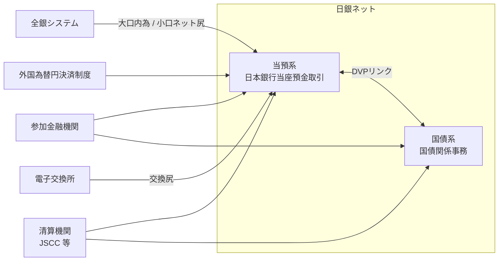

# 第1章 日銀ネットの概要と沿革

[← 仕様 目次へ](./README.md) ｜ [次章：稼働時間 →](./02_operating_hours.md)

---

## 1.1 日銀ネットとは

**日銀ネット**（正式名称：**日本銀行金融ネットワークシステム**、英語名 BOJ-NET）は、日本銀行と取引先金融機関等との間の **資金（円）** および **国債** の決済をオンライン処理で効率的かつ安全に行うために、日本銀行が構築・運営しているコンピュータ・ネットワークシステムです。

日本銀行の電算センターと、日本銀行本支店および参加金融機関が通信回線で接続されており、入力されたデータは電算センターでオンライン処理されます。

| 項目 | 内容 |
|---|---|
| 運営者 | 日本銀行（決済機構局・システム情報局 等） |
| 決済手段 | 中央銀行マネー（日本銀行当座預金）／振替国債 |
| 主な機能 | 当預系（資金決済）・国債系（国債決済） |
| 決済方式 | 即時グロス決済（RTGS）が基本。流動性節約機能付きRTGS、時点ネット決済等も提供 |
| 決済のファイナリティ | 日本銀行当座預金上での振替により、最終的かつ取消不能な決済が成立 |
| 位置付け | わが国の資金決済・証券決済の基幹インフラ（FMI） |

## 1.2 二つの業務系

- **当預系**（日本銀行当座預金取引）
  金融機関等が日本銀行に開設している当座預金の間で資金を振り替える資金決済システム。短期金融市場取引（コール等）、国債取引の資金決済、全銀システム・外国為替円決済制度・手形交換（電子交換所）といった民間資金決済システムの最終決済などを担います。
- **国債系**（国債関係事務）
  振替国債の受渡し（売買に伴う決済）、国債の入札・発行・払込み、元利金払いなどを処理します。日本銀行は社債、株式等の振替に関する法律（社株法）に基づく国債の **振替機関** です。

## 1.3 沿革（主要年表）

| 年月 | 出来事 |
|---|---|
| 1988年 | 日銀ネット稼働開始（時点ネット決済が中心） |
| 1994年 | 国債DVP（資金と国債の同時受渡）開始 |
| 1996年 | バックアップセンター設置 |
| 2001年1月4日 | 当座預金決済・国債決済の **RTGS化**。日中当座貸越・与信担保システム稼働 |
| 2008年10月 | 次世代RTGS第1期：**同時決済口と流動性節約機能** を導入、外為円決済のRTGS化 |
| 2011年11月 | 次世代RTGS第2期：全銀システムの大口内為取引（1件1億円以上）をRTGS化 |
| 2014年1月6日 | **新日銀ネット 第1段階** 稼働（国債売買関係事務、金融調節等入札連絡事務 等） |
| 2015年10月13日 | **新日銀ネット 全面稼働**（第2段階）。ISO 20022電文を採用 |
| 2016年2月15日 | 稼働時間を **8:30〜21:00** に拡大（フェーズⅠ） |
| 2025年11月25日 | 外為円決済等で利用する **ISO 20022電文を Version 3 → Version 8** に改訂 |
| 2026年9月 | 日銀ネット端末の旧OS構成（Windows 10 LTSB2016＋IE11 など）のサポート終了予定 |

> 注：年表は日本銀行の公表資料に基づく。細部の日付・範囲は日本銀行の一次資料で確認してください。

## 1.4 新日銀ネットの設計思想

2015年に全面稼働した現行システム（いわゆる「新日銀ネット」）は、旧システムの課題を踏まえ、次の方針で再構築されました。

1. **柔軟性・拡張性**：業務アプリケーションをモジュール化し、制度変更への対応を容易にする。
2. **アクセス利便性**：最新の情報通信技術を活用し、接続方式を多様化。
3. **国際標準への準拠**：電文フォーマットに **ISO 20022（XML）** を採用（欧米の中銀システムに先駆けた採用）。
4. **長時間稼働の可能性**：システム仕様上、長時間稼働が可能な設計（1日23時間半程度の稼働に耐える）。
5. **安全性・業務継続**：バックアップセンター、冗長化構成。

## 1.5 規模感

日本銀行「決済動向」によれば、2025年の1営業日平均で **資金決済 約9.5万件・約233兆円**、**国債決済 約3.7万件・約150兆円（額面）** が日銀ネットで決済されています。2026年5月には資金決済が1日平均 **約10万件・約252兆円** に達しました。詳しくは [第9章 数値で見る日銀ネット](./09_statistics.md) を参照してください。

## 参考資料

- 日本銀行「教えて！にちぎん：日銀ネットとは何ですか？」 https://www.boj.or.jp/about/education/oshiete/kess/i10.htm
- 日本銀行「決済システムレポート（2019年3月）」 https://www.boj.or.jp/research/brp/psr/psr190327.htm
- 日本銀行「日本銀行のシステム開発プロジェクト 新しい日本の決済システムを構築する」 https://www.boj.or.jp/about/annai/genba/focusboj/focusboj09.htm
- 日本銀行「『決済動向』の解説」 https://www.boj.or.jp/statistics/outline/exp/exkess.htm
- 日本銀行「決済動向（2026年5月）」 https://www.boj.or.jp/en/statistics/set/kess/release/2026/kess2605.pdf
