# 第2章 稼働時間と1日の業務スケジュール

[← 前章：概要](./01_overview.md) ｜ [目次](./README.md) ｜ [次章：接続方式 →](./03_connectivity.md)

---

## 2.1 オンライン稼働時間（現行）

日本銀行の決定「日銀ネットにおけるオンライン入力開始時刻等に関する件」（2015年7月31日決定、2016年1月19日改正）により、当座預金決済および国債決済にかかる **オンライン入力開始時刻は午前8時30分、入力締切時刻は午後9時** とされています。

| 区分 | 開始 | 締切 | 備考 |
|---|---|---|---|
| 通常日（当預系・国債系） | 8:30 | 21:00 | 2016年2月15日から |
| 月末日（年末日を除く） | **7:30** | 21:00 | 決済集中に対応し開始を前倒し |

### 同時決済口の時間帯

当座預金の同時決済口（流動性節約機能）にも受付時間帯があり、その中で定時の多者間探索が行われます。2008年の第1期資料では多者間探索は1日4回、2012年の分析では1日5回とされています。同時決済口の受付が終わると、残高は自動で通常口に戻ります（[第5章](./05_current_account_system.md)）。正確な時刻は利用先向けの規程で定められています。

## 2.2 稼働時間拡大の経緯

| 時期 | 当預系 | 国債系 |
|---|---|---|
| RTGS化前後（2001年頃） | 9:00〜（「5時同時処理」等） | 入力締切 16:30（発行日は延長） |
| 新日銀ネット稼働前 | 9:00（月末 8:30）〜19:00 | 9:00〜16:30 |
| 新日銀ネット第1段階以降 | 〜19:00 | 8:30〜19:00 に拡大 |
| 2016年2月〜（フェーズⅠ） | **8:30〜21:00** | **8:30〜21:00** |

21時までの拡大により、アジアのほぼ全域の日中時間、および欧州の午前中との **時間帯のオーバーラップ** が確保されました。さらなる拡大（フェーズⅡ）は「日銀ネットの有効活用に向けた協議会」で検討課題とされてきました。

## 2.3 1日の業務の流れ（モデル）

以下は理解のためのモデル図です（各時点処理の正確な時刻は制度ごとの規程を参照）。

```mermaid
gantt
    dateFormat HH:mm
    axisFormat %H:%M
    title 日銀ネットの1日（モデル）
    section 当預系
    オンライン開局・RTGS/流動性節約処理      :a1, 08:30, 12h30m
    電子交換所 交換尻決済（時点）             :milestone, 15:00, 0m
    全銀小口 ネット尻決済（夕刻・時点）       :milestone, 16:15, 0m
    section 国債系
    国債DVP・振替・担保受払                    :b1, 08:30, 12h30m
    section 同時決済口（流動性節約機能）
    受付・二者間探索（随時）                   :d1, 09:00, 8h
    多者間探索（定時：モデルの例）             :milestone, 11:00, 0m
    section 終業
    入力締切                                   :milestone, 21:00, 0m
    日中当座貸越の返済・日次締め               :c1, 21:00, 30m
```

### 主要な時間帯ごとの特徴

1. **開局直後（8:30〜）**：前日約定分の国債DVP、コール資金の受払、日本銀行オペの資金決済などが集中しやすい。
2. **日中**：RTGSによる個別決済、流動性節約機能（待ち行列・同時決済）による処理が続く。
3. **時点ネット決済**：電子交換所（当日15時に交換尻を受払）や全銀システム小口内為取引の決済尻など、決められた時点に差額を当座預金で受払う。
4. **夕刻〜21:00**：クロスボーダーの円資金決済（アジア・欧州時間帯）等。
5. **終業時**：日中当座貸越は終業時までに返済が必要。残ると基準貸付利率＋年6％の延滞利息がかかるため、翌日に持ち越すなら事前に補完貸付で置き換える（[仕組み 第4章](../02_mechanism/04_intraday_liquidity.md)）。

## 2.4 稼働時間設計上の論点

- **参加者のコスト**：稼働時間延長は、金融機関側の要員・システム運用コストを増加させる。
- **流動性の偏在**：夜間に決済が少ないと、資金の受け待ち（グリッドロック）が起きやすい。
- **国際連携**：海外中銀RTGSとの時間帯重複は、PvP（同時決済）やクロスボーダー担保の前提となる。
- **障害時の延長**：システム障害や決済遅延時には稼働時間の延長措置がとられることがある。

## 参考資料

- 日本銀行「日銀ネットにおけるオンライン入力開始時刻等に関する件」 https://www.boj.or.jp/paym/bojnet/bojnet01.htm
- 日本銀行「日銀ネットのさらなる有効活用に向けて」（2017年2月3日） https://www.boj.or.jp/paym/bojnet/net_forum/rel170203b.htm
- 日本銀行「クロスボーダー円資金決済の発展に向けて」（2017年6月） https://www.boj.or.jp/research/wps_rev/rev_2017/rev17j11.htm
- 日本銀行「RTGS化実施日の決定および日銀ネット国債系稼働時間の延長について」（2000年12月） https://www.boj.or.jp/paym/bojnet/rtgs/set0012b.htm
- 日本銀行「教えて！にちぎん：民間資金決済システムでの金融機関間の受払」 https://www.boj.or.jp/about/education/oshiete/kess/i27.htm
