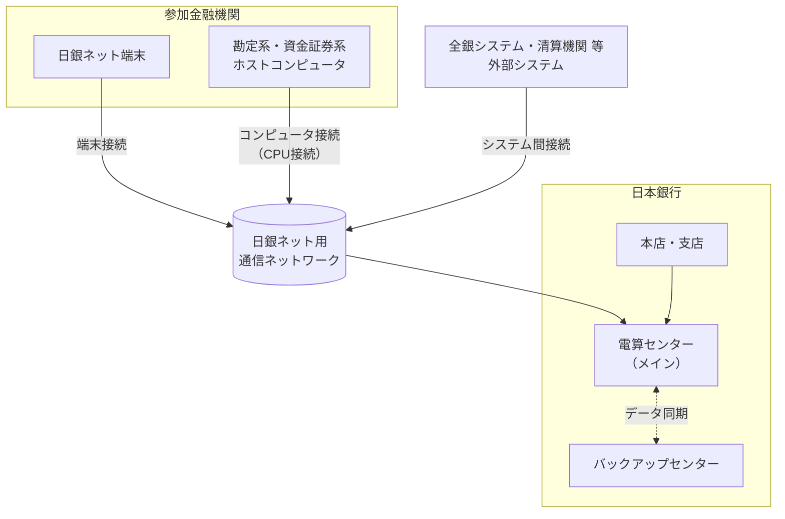
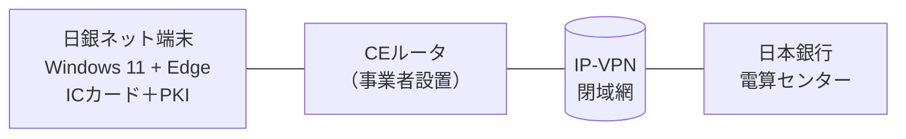

# 第3章 接続方式とネットワーク構成

[← 前章：稼働時間](./02_operating_hours.md) ｜ [目次](./README.md) ｜ [次章：電文仕様 →](./04_message_format.md)

---

## 3.1 全体構成

## 3.2 接続形態

日銀ネットと金融機関等との接続は、大きく次の2つです。

| 接続形態 | 概要 | 主な利用者像 |
|---|---|---|
| **端末接続** | 日銀ネット端末から画面操作で指図を入力・照会 | 取引件数の少ない先、バックアップ用途 |
| **コンピュータ接続（CPU接続）** | 参加先のホストシステムと日銀ネットを直接接続し、電文を自動送受信（STP） | 大手行、証券会社、清算機関、民間決済システム |

多くの大口参加者は、勘定系・資金証券系システムと日銀ネットを直接接続し、約定から決済までを自動化（STP: Straight Through Processing）しています。また、ベンダーが提供する共同利用型の接続・流動性管理サービスを利用する先もあります。

## 3.3 日銀ネット端末の利用環境（2026年3月時点の公表資料）

日本銀行システム情報局「日銀ネットを利用するための機器等（端末装置用）」（2026年3月）に、端末接続の要件が公表されています。

| 項目 | 内容 |
|---|---|
| 回線 | 日本銀行の指示で敷設する **IP-VPN回線**（インターネット接続ではない閉域網）。回線終端装置・CEルータは通信事業者が用意 |
| 接続台数 | CEルータに接続できるのはPC・ネットワークプリンタ合計8台まで。超える場合はL2スイッチングハブが必要 |
| 認証 | 日本銀行が貸与する **ICカード**（権限者カード、権限者登録カード、端末認証装置）と、日本銀行指定のPKI製品。ICカードリーダライタは指定機種 |
| ウイルス対策 | 指定の製品を利用し、定義ファイルはオンラインで配信 |
| OS・ブラウザ | Windows 11 Enterprise 24H2＋Microsoft Edge が現行構成。Windows 10 Enterprise LTSB2016＋IE11、Windows 11 23H2＋Edge 120 は **2026年9月にサポート終了予定** |
| 更新 | セキュリティ更新は日本銀行の指示に基づいて適用。OSは日本銀行のセットアッププログラムで導入 |
| 非対応 | Windowsタブレット（Surface 等）は非対応 |

## 3.4 ネットワークの高度化の経緯

- **2002年**：「日銀ネットのネットワークインフラの高度化」により、IP系の技術を取り入れた通信基盤への移行方針が示されました。
- **新日銀ネット（2014〜2015年）**：最新の情報通信技術を用い、柔軟性・アクセス利便性の向上を図る設計となりました。
- **グローバル・アクセス**：日銀ネット端末の国外設置（海外拠点からの利用）が協議会で議論されました（2017年）。

## 3.5 セキュリティ上の主な要件（概念整理）

公表資料と一般的な中銀RTGSの要件から整理すると、接続には次のような統制がかかります（詳細な技術仕様は利用先向けの非公開資料で規定）。

| 観点 | 主な統制 |
|---|---|
| 閉域性 | 専用のネットワークを利用し、一般インターネットから隔離 |
| 本人確認 | ICカード・電子証明書（PKI）による認証（端末接続の場合、日本銀行が貸与） |
| 権限管理 | 入力者・承認者の分離（マルチ承認）、業務権限の付与 |
| 完全性 | 電文の改ざん検知、通番管理、重複送信の排除 |
| 可用性 | 回線の二重化、バックアップセンターへの切替 |

## 3.6 実務上のポイント

1. **接続テスト**：新規接続や電文改訂（例：ISO 20022のバージョン改訂）時には、日本銀行が提供するテスト環境で接続試験を実施します。
2. **運転試験**：大規模改訂時は、参加者全体で「総合運転試験」を実施した前例があります（RTGS化時）。
3. **障害時運用**：コンピュータ接続先が障害の場合、端末による代替入力などのコンティンジェンシー手順を備えます。

> 本章のネットワーク詳細（回線種別・プロトコル等）は利用先限定の資料で定められており、本書は公表情報の範囲で概念的に整理しています。

## 参考資料

- 日本銀行システム情報局「日銀ネットを利用するための機器等（端末装置用）」（2026年3月） https://www5.boj.or.jp/bojnet/pc/data/pc02a.pdf
- 日本銀行「業務上の事務連絡：通知類（留意事項等）」 https://www5.boj.or.jp/bojnet/nettuuchi.htm
- 日本銀行「日銀ネットのネットワークインフラの高度化について」（2002年1月） https://www.boj.or.jp/paym/bojnet/other/set0201a.htm
- 日本銀行「教えて！にちぎん：日銀ネットとは何ですか？」 https://www.boj.or.jp/about/education/oshiete/kess/i10.htm
- 日本銀行「中央銀行決済システムの将来」関連公表（2017年4月） https://www.boj.or.jp/paym/bojnet/net_forum/rel170425b.htm
