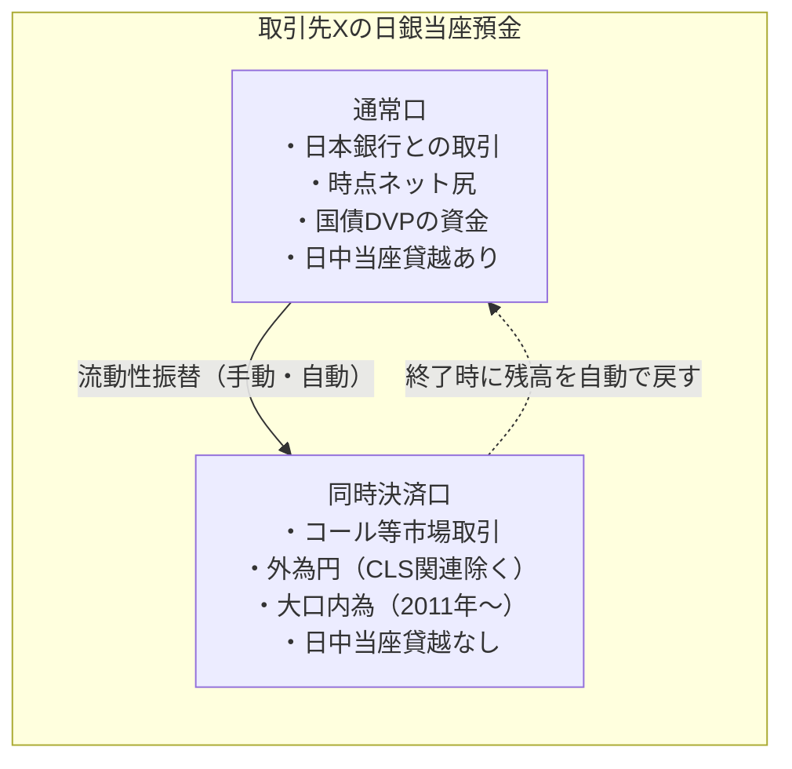
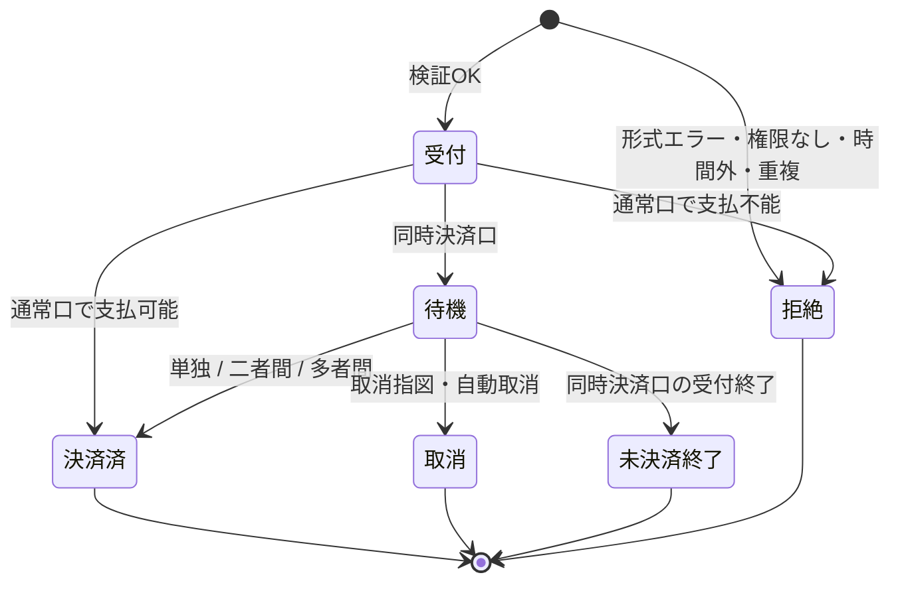

# 第5章 当預系（日本銀行当座預金取引）の業務仕様

[← 前章：電文仕様](./04_message_format.md) ｜ [目次](./README.md) ｜ [次章：国債系の業務仕様 →](./06_jgb_system.md)

---

## この章で分かること

- 当座預金が **「通常口」と「同時決済口」の2つの勘定** に分かれている理由
- どの決済がどちらの勘定で、どの方式（RTGS／流動性節約機能付きRTGS／時点ネット）で処理されるか
- 日中当座貸越、流動性振替、待ち行列、締切時の扱い

---

## 5.1 当預系の役割

当預系は、金融機関等が日本銀行に開設している **日本銀行当座預金（日銀当預）** の間の振替で資金決済を行うシステムです。中央銀行マネーで決済するため、決済相手の信用リスクを伴わない、**ファイナリティのある決済** になります。

## 5.2 取り扱う主な決済

日本銀行の「決済動向」の分類に沿うと、日銀当預で決済される資金は次の3つに大別されます。

| 区分 | 具体例 |
|---|---|
| (1) 取引先間の当座預金振替等 | コール取引等、国債DVPの資金決済、大口内為取引（1件1億円以上）、外為円取引 |
| (2) 民間の集中決済制度の資金決済 | 手形交換（電子交換所）の交換尻、全銀システム（小口内為取引）の決済尻 |
| (3) その他 | 日本銀行と取引先の間のオペ（国債系オペを除く）、銀行券の受払 等 |

## 5.3 二つの勘定：通常口と同時決済口

2008年10月の **次世代RTGS第1期** で、当座預金は **当座勘定（通常口）** と **当座勘定（同時決済口）** に分かれました。流動性節約機能は同時決済口だけで動きます。同時決済口は1先につき1口座です。

| 項目 | 通常口 | 同時決済口 |
|---|---|---|
| 主な決済 | 日本銀行との取引（オペ・貸出・銀行券・国庫金）、時点ネット尻、国債DVPの資金 | コール・NCD・DVP以外の証券資金などの市場取引、外為円（CLS関連を除く）、大口内為 |
| 決済方式 | RTGS（即時グロス） | 流動性節約機能付きRTGS（待ち行列＋同時決済） |
| 残高不足のとき | 決済されない | 待ち行列に入り、受取や同時決済を待つ |
| 日中当座貸越 | **あり**（担保の範囲内） | **なし** |
| 資金の入れ方 | 日本銀行との取引・受取 | 通常口からの流動性振替（手動・自動）、受取 |
| 終業時の残高 | 当座預金残高として残る | 受付終了時に通常口へ自動で戻る |

> 出典：日本銀行決済機構局「次世代RTGSプロジェクト －第1期対応を中心に－」（2008年10月）、同「次世代RTGS第2期対応実施後の資金決済の状況」（2012年9月）。新日銀ネット（2015年〜）での細部の扱いは利用先向けの規程・仕様書で確認してください。

### なぜ勘定を分けたのか

- **流動性節約機能の対象を明確にするため**：互いに相殺し合う市場取引や大口内為を一か所に集めると、同時決済が成立しやすくなります。2012年の日本銀行の分析は、3種類の取引を同じ口座で決済することによる節約効果を、第2期前で約1兆円、第2期後で3兆円弱と推計しています。
- **日本銀行との取引や時点ネット尻を確実に処理するため**：これらは待たせずに処理する必要があるため、日中当座貸越が使える通常口に置かれます。

## 5.4 決済方式の一覧

| 方式 | 勘定 | 処理の流れ | 主な対象 |
|---|---|---|---|
| **RTGS** | 通常口 | 支払可能額（残高＋日中当座貸越の余力）があれば即時に決済、なければ不成立 | 日本銀行との取引、国債DVPの資金 |
| **流動性節約機能付きRTGS** | 同時決済口 | 待ち行列 → 単独決済・二者間探索（変化の都度）・多者間探索（1日数回の定時） | 市場取引、外為円、大口内為 |
| **時点ネット決済** | 通常口 | 民間システムが計算した受払差額を、決められた時点に一括で受払 | 電子交換所の交換尻（当日15時）、全銀システム小口の決済尻 |

### 流動性節約機能の公表されている仕様

| 機能 | 内容（公表資料による） |
|---|---|
| 待ち行列 | 残高が不足する支払指図は拒絶せず、待ち行列に置く |
| 二者間の探索 | 指図の入力、残高の増加、待ち行列の順序変更など **変化があるたびに** 実行し、相殺できる組を探す |
| 多者間の探索 | **定時** に実行（第1期資料では1日4回、第2期後の分析では1日5回）。3者以上の組合せで、不足なく同時に決済できるものを探す |
| 待ち行列の順序変更 | 参加者は自行の待ち行列の順序を変えられる（変更で二者間探索が走る） |
| 自動取消 | 一定時刻に未決済の指図を自動で取り消す取扱いがある |
| 返金先行 | コール等で、返金の指図が待ち行列に入れば、それに依存する放出の指図も入れられる |

> アルゴリズムの詳しい考え方は [仕組み 第2章](../02_mechanism/02_rtgs_and_lsf.md)、実際に動かすには [模擬システム](../03_simulator/README.md) を参照。

## 5.5 指図の種類

| 指図 | 内容 | 勘定 |
|---|---|---|
| 当座預金振替 | 取引先A → 取引先B の振替 | 通常口 |
| 同時決済指図 | 流動性節約機能の対象として入力する指図 | 同時決済口 |
| 流動性振替 | 通常口 ⇄ 同時決済口の資金移動。定時の自動振替も設定できる | 両方 |
| 日本銀行との取引 | オペ資金、貸出・返済、銀行券受払、国庫金など | 通常口 |
| 順序変更・取消 | 待機中の同時決済指図の順序変更・取消 | 同時決済口 |
| 照会 | 残高、待ち行列、受取予定、日中当座貸越の利用状況、担保余力 | 両方 |

## 5.6 指図の状態遷移

## 5.7 日中流動性の仕組み

| 項目 | 規程上の取扱い（日本銀行「日中当座貸越」） |
|---|---|
| 対象先 | 当座預金取引または貸出取引の相手方として選定された取引先 |
| 対象勘定 | 同時決済口 **以外** の当座勘定 |
| 担保 | 適格担保を根担保として差入れ |
| 極度額 | 差し入れた担保の担保価額の合計額 |
| 返済期限 | 貸越を行った日の **終業時** |
| 利息 | 徴収しない |
| 終業時に残った場合 | **基準貸付利率に年6％を加えた利率** で延滞利息を徴収 |
| 国債DVPとの関係 | 国債と資金を同時に受け渡す取引で、資金の支払・払込に必要な場合に行われることがある |

日中当座貸越を翌日に持ち越したい場合は、終業前に **補完貸付**（担保の範囲内、原則として基準貸付利率、翌営業日返済）を利用して置き換えるのが通常の対応です（[第8章](./08_monetary_operations.md)）。

## 5.8 照会できる情報

参加者は以下の情報をリアルタイムに照会し、資金繰りに使います。

- 通常口・同時決済口の残高、日中当座貸越の極度額と利用額、担保余力
- 待ち行列にある自行の支払指図（順位）と、他行から自行への受取予定
- 決済済指図の明細、時点ネット決済の予定額
- 担保差入状況（担保価額）

## 確認問題

Q1. 日中当座貸越は同時決済口の支払に直接使えるか？

使えません。日中当座貸越は同時決済口以外の当座勘定（通常口）で行われます。同時決済口に資金が必要なら、通常口から流動性振替で移します（通常口の資金が日中当座貸越で賄われている場合も含みます）。

Q2. 二者間探索と多者間探索は、それぞれいつ実行されるか？

二者間探索は、指図の入力・残高の増加・順序変更などの変化があるたびに実行されます。多者間探索は1日数回の定時に実行されます。

Q3. 終業時に日中当座貸越が残ったらどうなるか？

基準貸付利率に年6％を加えた利率で延滞利息がかかります。これを避けるため、参加者は受取や資金調達で返済するか、補完貸付に置き換えます。

## 参考資料

- 日本銀行決済機構局「次世代RTGSプロジェクト －第1期対応を中心に－」（2008年10月） https://www.boj.or.jp/paym/bojnet/next_rtgs/set0810a.pdf
- 日本銀行決済機構局 土屋宰貴「次世代RTGS第2期対応実施後の資金決済の状況」（2012年9月） https://www.boj.or.jp/research/brp/ron_2012/data/ron120925a.pdf
- 日本銀行「日中当座貸越」 https://www.boj.or.jp/paym/torihiki/touyo11.htm
- 日本銀行「『決済動向』の解説」 https://www.boj.or.jp/statistics/outline/exp/exkess.htm
- 日本銀行「教えて！にちぎん：民間資金決済システムでの金融機関間の受払」 https://www.boj.or.jp/about/education/oshiete/kess/i27.htm
