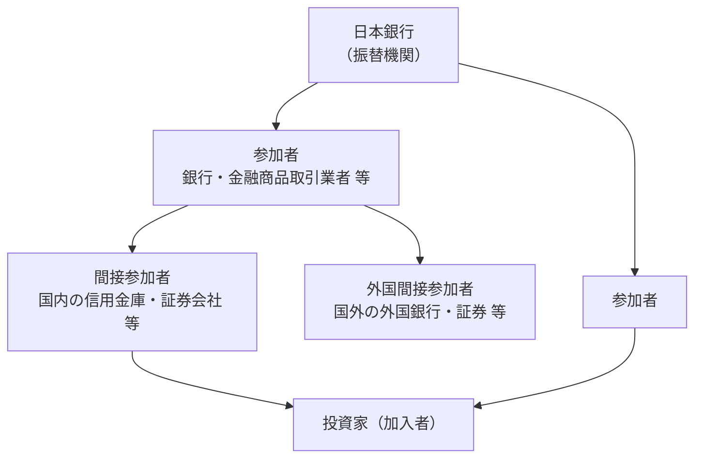

# 第6章 国債系（国債関係事務）の業務仕様

[← 前章：当預系](./05_current_account_system.md) ｜ [目次](./README.md) ｜ [次章：参加資格と運用規程 →](./07_participation_and_governance.md)

---

## 6.1 国債系の役割

国債系は、日本銀行が **振替機関** として運営する **国債振替決済制度** をオンラインで処理するシステムです。国債振替決済制度は社株法に基づき、無券面化された国債（**振替国債**）のみを取扱対象としています。

| 主な業務 | 内容 |
|---|---|
| 振替（受渡し） | 売買・レポ等に伴う国債の口座間振替（フリー振替／DVP振替） |
| 発行関係 | 入札、発行、払込み（新発国債の参加者口座への記録） |
| 元利払い | 利払期日・償還期日の元利金支払 |
| 担保関係 | 日本銀行への担保差入・返戻、同時担保受払 |
| 金融調節 | 国債買入・売却オペ、国債補完供給等の入札連絡・決済 |

## 6.2 参加形態

国債振替決済制度の参加形態は階層構造になっています。

- **参加者**：日本銀行に直接口座を開設。**日銀ネット国債系は参加者のみが利用可能**。
- **間接参加者／外国間接参加者**：参加者（口座管理機関）を通じて口座を保有。
- 承認基準は「参加者、間接参加者および外国間接参加者の承認基準」として公表されています。

## 6.3 振替の種類

| 種類 | 概要 |
|---|---|
| **DVP振替** | 当預系の資金決済と紐づけ、資金と国債が同時に受渡される（[仕組み 第3章](../02_mechanism/03_jgb_dvp.md)） |
| **フリー振替（FOP）** | 資金決済を伴わない国債のみの振替（担保移転、口座間移管等） |
| 発行・払込 | 入札結果に基づき国債を記録し、払込金を当預から引落 |
| 元利金支払 | 期日に保有残高に応じて元利金を当座預金へ入金 |

## 6.4 即時グロス決済の流れ

1. 渡方（売り手）または関係者が日銀ネット国債系で **振替申請** を入力。
2. DVPの場合は受方の確認・照合（制度により申請と通知の組み合わせ）。
3. システムが渡方の **国債残高の確保** を確認。
4. DVPの場合は受方の **資金（当座預金残高＋日中当座貸越枠）** を確認。
5. 1件ごとに直ちに振替（および資金決済）を実行。

日本銀行は参加者間の個々の国債決済の取引当事者とならないため、**信用リスク・資金流動性リスクを負いません**。

## 6.5 新日銀ネットでの主な制度変更

- **利払期日前の振替停止期間の廃止**：旧来は利払期日前に振替ができない期間があったが、新日銀ネットで廃止（清算機関の業務方法書等もこれに合わせて改正）。
- **国債系稼働時間の拡大**：8:30〜19:00、その後21:00まで。
- **決済期間の短縮**：国債アウトライト取引の決済期間は2018年5月に **T+1** へ短縮（市場慣行。日銀ネットの処理能力・稼働時間がこれを支える）。

## 6.6 国際的な連携（クロスボーダー担保）

日本銀行は、日本国債を担保とした本邦金融機関の外貨調達を支えるため、**香港金融管理局（HKMA）** との間で、日銀ネット国債系と香港ドルRTGSを連携させたクロスボーダー担保の仕組みを整備しています（2019年の決済システムレポートで言及）。

## 参考資料

- 日本銀行「国債振替決済制度に関する自己評価」等（FMI原則に基づく情報開示） https://www.boj.or.jp/paym/outline/pay_boj/pboj230731b.pdf
- 日本銀行（同上・過年版） https://www.boj.or.jp/paym/outline/pay_boj/rel210730g.pdf
- 日本証券クリアリング機構「新日銀ネットの稼働等に伴う国債店頭取引清算業務に関する業務方法書等の一部改正について」 https://www.jpx.co.jp/jscc/kisoku/regulations/cimhll0000000v34-att/jgbshinkyu20150811.pdf
- 日本銀行「決済システムレポート（2019年3月）」 https://www.boj.or.jp/research/brp/psr/psr190327.htm
