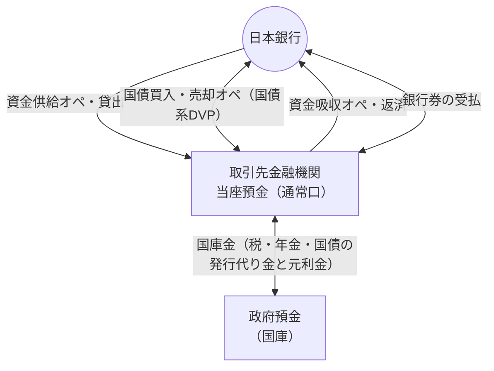

# 第8章 日本銀行との取引：金融調節・貸出・国庫金

[← 前章：参加資格と運用規程](./07_participation_and_governance.md) ｜ [目次](./README.md) ｜ [次章：数値で見る日銀ネット →](./09_statistics.md)

---

## この章で分かること

- 日本銀行自身が取引の当事者になる決済（オペ・貸出・国庫金・銀行券）が、日銀ネットでどう処理されるか
- 補完貸付と日中当座貸越の違い

---

## 8.1 日本銀行が当事者となる取引の全体像

日銀ネットでは、取引先どうしの決済に加え、**日本銀行と取引先の間の取引** も処理されます。これらは通常口で決済されます。

## 8.2 金融調節（オペレーション）

| 種類 | 日銀ネットでの流れ | 系 |
|---|---|---|
| 入札の連絡 | 日本銀行がオファー → 取引先が応札 → 結果の通知（「金融調節等入札連絡事務」） | 国債系（新日銀ネット第1段階の対象業務） |
| 資金供給オペ（共通担保オペ等） | 担保の範囲で日本銀行が当座預金に入金、期日に引落 | 当預系 |
| 国債買入・売却オペ | 国債と資金を DVP で受け渡す | 国債系＋当預系 |
| 国債補完供給 | 日本銀行が保有国債を一時的に供給（市場の流動性確保） | 国債系 |

## 8.3 日本銀行の貸出

### 補完貸付制度（ロンバート型貸出）

| 項目 | 内容（日本銀行の公表資料） |
|---|---|
| 性格 | 金融機関等の借入申込みを受け、日本銀行が **受動的に** 実行する貸付け |
| 担保 | 差し入れた担保の範囲内 |
| 金利 | 原則として **基準貸付利率** |
| 期間 | **翌営業日** を返済期限とする |
| 利用日数 | 原則として1積み期間あたり5営業日までは基準貸付利率、超えると基準貸付利率＋2.0％。ただし2003年3月から、全営業日を通じて基準貸付利率で借りられる臨時措置が続いている |

### 日中当座貸越との比較

| 項目 | 日中当座貸越 | 補完貸付 |
|---|---|---|
| 目的 | 日中の決済タイミングのずれを埋める | 翌日まで資金を借りる（金利の上限を画す機能も持つ） |
| 期間 | 当日の終業時まで | 翌営業日まで |
| 利息 | なし（期限内に返済した場合） | 基準貸付利率 |
| 期限を過ぎた場合 | 基準貸付利率＋年6％の延滞利息 | ― |
| 担保 | 共通担保（同じ担保プール） | 共通担保（同じ担保プール） |

> 模擬システムでは、担保価額の合計から補完貸付の残高を差し引いた額を日中当座貸越の極度額としています（同じ担保プールを共有するモデル）。

## 8.4 国庫金

政府の資金（国庫金）は日本銀行の **政府預金** で管理されます。

| 取引 | 当座預金の動き |
|---|---|
| 税・保険料の受入れ | 金融機関の当座預金 → 政府預金 |
| 年金・公共事業費などの支払 | 政府預金 → 金融機関の当座預金 |
| 国債の発行代り金 | 落札先の当座預金 → 政府預金（国債系で発行・払込） |
| 国債の元利金支払 | 政府預金 → 保有者（参加者）の当座預金 |

国庫金の大きな受払がある日（税の納期、年金支払日、国債の発行日・利払日など）は、当座預金残高が大きく動きます。金融機関は事前に把握して資金繰りを組みます。

## 8.5 銀行券の受払

金融機関が日本銀行の本支店で銀行券を受け取る（引出し）と当座預金が減り、預け入れると増えます。年末や連休前は銀行券の需要が増え、当座預金からの引出しが増えます。

## 確認問題

Q1. 補完貸付と日中当座貸越は、どちらが「翌日まで」借りられる仕組みか？

補完貸付です。日中当座貸越は当日の終業時までに返済が必要です。

Q2. 国債の発行日に当座預金残高はどう動くか？

落札した金融機関の当座預金から払込金が引き落とされ、政府預金に入ります。同時に国債が落札先の口座に記録されます。

## 参考資料

- 日本銀行「補完貸付制度」 https://www.boj.or.jp/mopo/measures/mkt_ope/len_a/index.htm
- 日本銀行「日中当座貸越」 https://www.boj.or.jp/paym/torihiki/touyo11.htm
- 日本銀行「日本銀行のシステム開発プロジェクト」（新日銀ネットの第1段階対象業務） https://www.boj.or.jp/about/annai/genba/focusboj/focusboj09.htm
