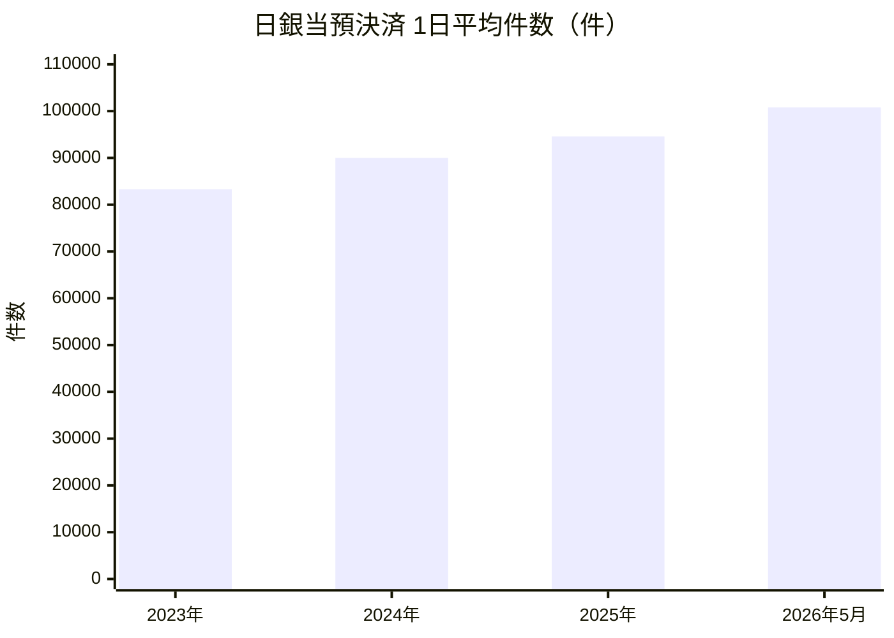

# 第9章 数値で見る日銀ネット

[← 前章：日本銀行との取引](./08_monetary_operations.md) ｜ [目次](./README.md)

---

## この章で分かること

- 日銀ネットで1日にどれだけの資金・国債が決済されているか
- 次世代RTGS（流動性節約機能・大口内為のRTGS化）が何をもたらしたか

---

## 9.1 決済の規模（日次平均）

日本銀行「決済動向」（2026年5月分、2026年6月30日公表）より。

| 期間 | 日銀当預決済（日銀ネット資金振替）件数 | 同 金額 | 国債決済 件数 | 同 金額（額面） |
|---|---:|---:|---:|---:|
| 2023年 | 83,311件 | 234.7兆円 | 31,527件 | 約131.2兆円 |
| 2024年 | 89,998件 | 233.8兆円 | 35,161件 | 約144.3兆円 |
| 2025年 | 94,602件 | 232.6兆円 | 37,413件 | 約150.1兆円 |
| 2025年5月 | 94,623件 | 228.2兆円 | 37,728件 | 約148.7兆円 |
| 2026年5月 | 100,790件 | 251.5兆円 | 39,141件 | 約162.5兆円 |

- 2026年5月は、前年同月比で資金決済の件数が **+6.5%**、金額が **+10.2%**。国債決済は件数 **+3.7%**、金額 **+9.2%**。
- 1営業日に **約250兆円** の資金が動く計算です。日本の名目GDP（年間約600兆円規模）の4割ほどが **1日で** 決済されていることになります。

### 過去との比較

| 時点 | 資金決済（日次平均） | 国債決済（日次平均） | 出典 |
|---|---|---|---|
| 2008年 | 約3.5万件・約121兆円 | 約1.8万件・約90兆円 | NTTデータ発表資料（2011年） |
| 2018年頃 | 約150兆円 | 約80兆円 | 決済システムレポート（2019年3月） |
| 2025年 | 約9.5万件・約233兆円 | 約3.7万件・約150兆円 | 決済動向 |

件数は2008年から約2.7倍に増えています。

## 9.2 次世代RTGSの効果（2012年の日本銀行の分析）

次世代RTGS第2期（2011年11月、大口内為のRTGS化）の前後を比べた日本銀行の分析（日次平均）。

| 指標 | 第2期前（2010年11月〜2011年3月） | 第2期後（2011年11月〜2012年3月） |
|---|---|---|
| 決済のために投入された流動性 | 約15兆円 | 約23兆円 |
| 決済に使われなかった流動性 | 約3兆円 | 約8兆円 |
| 平均決済時刻 | ― | **約2時間前倒し** |
| 待ち行列・同時決済機能による流動性節約効果 | 通常のRTGS比で **1日約1〜3兆円**（第2期後は流動性投入の増加でやや低下） | |
| 3種類の取引を同一口座で決済する効果 | 約1兆円 | 3兆円弱 |
| 全銀システムの仕向超過限度額の合計 | ― | 約2兆円減少 |
| 仕向超過額のピーク／限度額 | 通常日 約15％、月末 30〜40％ | 通常日 約3％、月末 10〜15％ |

**読み取れること**

1. 大口内為を時点ネットからRTGSに移したことで、決済が **早い時間に完了** するようになりました（決済リスクの削減）。
2. 流動性節約機能は、同じ決済をより少ない流動性で処理できる効果を、1日あたり兆円単位で生んでいます。
3. 全銀システムの未決済リスク（仕向超過）が大きく縮小しました。

> 模擬システムの [比較実験](../03_simulator/README.md#5-シミュレーション実験) では、流動性を絞ったときに多者間探索が決済を大きく改善する様子を再現できます（数値は模擬上のもの）。

## 9.3 統計の見方

| 統計 | 内容 | 公表 |
|---|---|---|
| 決済動向 | 日銀当預決済、国債決済、全銀システム、電子交換所、外為円などの件数・金額 | 毎月（翌月最終営業日） |
| 決済システムレポート | 決済インフラの動向と日本銀行の取組みの分析 | 不定期 |
| PFMI に基づく情報開示 | 日銀ネット・国債振替決済制度のリスク管理の自己評価 | 定期 |

## 参考資料

- 日本銀行「決済動向（2026年5月）」 https://www.boj.or.jp/en/statistics/set/kess/release/2026/kess2605.pdf
- 日本銀行「『決済動向』の解説」 https://www.boj.or.jp/statistics/outline/exp/exkess.htm
- 日本銀行決済機構局 土屋宰貴「次世代RTGS第2期対応実施後の資金決済の状況」（2012年9月） https://www.boj.or.jp/research/brp/ron_2012/data/ron120925a.pdf
- 日本銀行「決済システムレポート（2019年3月）」 https://www.boj.or.jp/research/brp/psr/psr190327.htm
- NTTデータ「新日銀ネット構築」関連リリース（2011年） https://www.nttdata.com/global/ja/news/release/2011/020200-01
