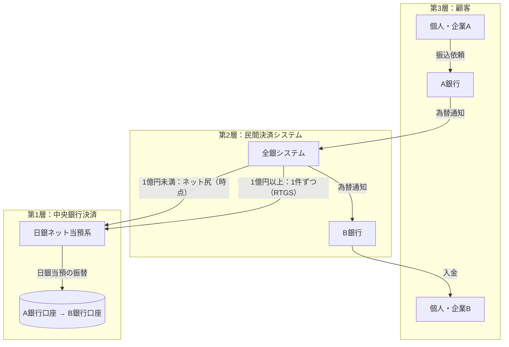

# 第1章 わが国決済システムの全体像と日銀ネットの位置付け

[← 仕組み 目次へ](./README.md) ｜ [次章：RTGSと流動性節約機能 →](./02_rtgs_and_lsf.md)

---

## 1.1 「最終決済」はなぜ中央銀行で行うのか

銀行間の支払は、最終的に「どの資産で決済するか」が問題になります。

| 決済資産 | 特徴 |
|---|---|
| 民間銀行の預金（商業銀行マネー） | 支払先の銀行が破綻すれば価値を失う（信用リスク） |
| **中央銀行の当座預金（中央銀行マネー）** | 発行主体の信用リスクがなく、受け取った時点で最終的（ファイナリティ） |

そのため、各国とも大口の銀行間決済は中央銀行の当座預金で行うのが原則であり、日本ではそれを担うのが日銀ネットです。

## 1.2 決済の階層構造

個人の振込やATM送金も、最後は日銀ネットに行き着きます。

## 1.3 日銀ネットに接続する主なシステム

| システム | 運営者 | 日銀ネットでの決済方法 |
|---|---|---|
| 全銀システム（内国為替） | 全銀ネット | 大口（1件1億円以上）はRTGS、小口はネット尻を時点決済 |
| 外国為替円決済制度 | 全国銀行協会 | 2008年10月から完全RTGS |
| 電子交換所（手形・小切手） | 全国銀行協会 | 交換尻を当日15時に受払 |
| 国債店頭取引清算（JGB清算） | 日本証券クリアリング機構 | 国債DVP（清算機関経由） |
| 証券保管振替機構（社債・株式等） | ほふり／ほふりクリアリング | 資金決済に日銀当預を利用（DVP） |
| CLS（外為PvP） | CLS Bank | 円資金の受払に日銀当預を利用 |

## 1.4 日銀ネットが提供する「三つの価値」

1. **安全性**：中央銀行マネーによるファイナリティ、RTGSによるシステミック・リスクの削減、DVPによる元本リスクの除去。
2. **効率性**：流動性節約機能や同時担保受払により、少ない資金・担保で多くの決済を処理。
3. **利便性**：長時間稼働、ISO 20022、STP接続によりクロスボーダーを含む決済を迅速化。

## 1.5 用語整理

| 用語 | 意味 |
|---|---|
| ファイナリティ | 決済が無条件かつ取消不能となり、最終的に完了した状態 |
| RTGS | Real-Time Gross Settlement：即時グロス決済 |
| DNS | Designated-time Net Settlement：時点ネット決済 |
| DVP | Delivery versus Payment：証券と資金の同時受渡 |
| PvP | Payment versus Payment：異なる通貨の同時受渡 |
| システミック・リスク | 一参加者の不履行が連鎖的に他の参加者の不履行を招くリスク |
| グリッドロック | 互いに受取待ちとなり、資金があっても決済が進まない状態 |

## 確認問題

Q1. 銀行間の大口決済を中央銀行の当座預金で行うのはなぜか？

中央銀行マネーには発行主体の信用リスクがなく、受け取った時点で最終的な決済（ファイナリティ）になるからです。

Q2. 全銀システムの振込は、日銀ネットでどう決済されるか？

1件1億円以上の大口は1件ごとにRTGSで、1億円未満の小口は受払差額（決済尻）を時点ネットで、いずれも日銀当座預金で決済されます。

## 参考資料

- 日本銀行「教えて！にちぎん：民間資金決済システムでの金融機関間の受払」 https://www.boj.or.jp/about/education/oshiete/kess/i27.htm
- 日本銀行「『決済動向』の解説」 https://www.boj.or.jp/statistics/outline/exp/exkess.htm
- 日本銀行「決済システムレポート（2019年3月）」 https://www.boj.or.jp/research/brp/psr/psr190327.htm
