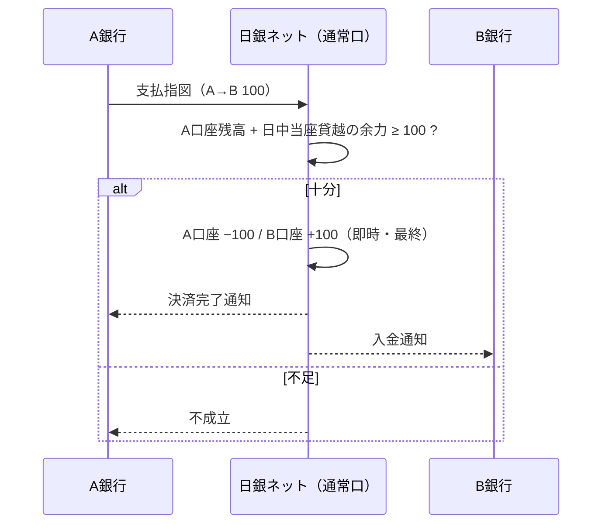
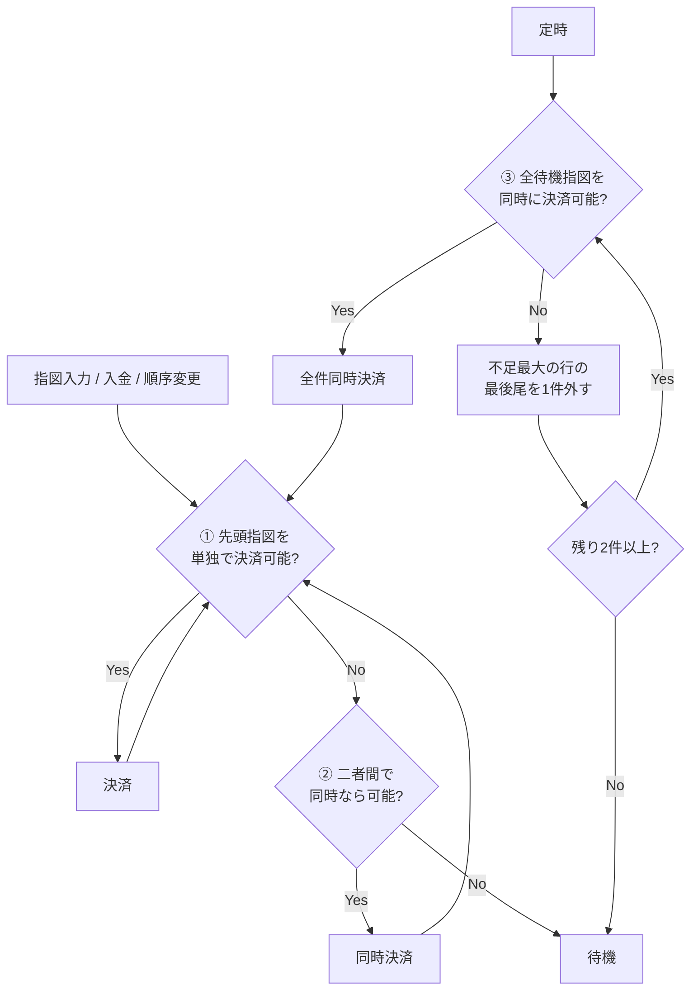

# 第2章 RTGS・時点ネット決済・流動性節約機能の仕組み

[← 前章：全体像](./01_payment_landscape.md) ｜ [目次](./README.md) ｜ [次章：国債DVP →](./03_jgb_dvp.md)

---

## この章で分かること

- 時点ネット決済とRTGSの長所・短所、日銀ネットがRTGSに移った理由
- 「グリッドロック」がなぜ起き、流動性節約機能がどう解くのか
- 日銀ネットの同時決済口の実際の設計と、その定量的な効果

---

## 2.1 時点ネット決済（DNS）

1日の取引の受払差額を、決められた時点でまとめて決済します。

**例**：A・B・Cの3行間の支払

| 支払 | 金額 |
|---|---|
| A → B | 100 |
| B → C | 80 |
| C → A | 50 |

ネット尻：A = −100 + 50 = **−50**、B = +100 − 80 = **+20**、C = +80 − 50 = **+30**（合計ゼロ）

- 長所：必要な資金は差額（Aの50）だけで済む。
- 短所：時点まで決済が完了しない。**1行が払えないと全体の計算をやり直す（アンワインド）** 必要があり、その影響が連鎖する（システミック・リスク）。

日銀ネットも1988年の稼働当初は時点ネット決済が中心でしたが、このリスクを削減するため **2001年1月にRTGSへ移行** しました。

## 2.2 即時グロス決済（RTGS）

支払指図を **1件ごと、即時に、総額（グロス）で** 決済します。

- 長所：決済の都度ファイナリティが得られ、不履行が連鎖しにくい。
- 短所：総額を払うための **流動性（資金・日中当座貸越）が大量に必要**。各行が「入金を待ってから払おう」とすると決済が遅れる（**待ち合い**）。全員が待つと誰も払えない **グリッドロック** に陥る。

### グリッドロックが起きる理由（ゲーム理論的な見方）

流動性は有限で、借りればコスト（担保や機会費用）がかかります。各行にとっては **他行からの受取を待って、その資金で払う** のが合理的です。ところが全員が同じ行動をとると、受取が来ないので誰も払えません。日本銀行金融研究所の研究（牧本直樹「銀行間資金決済ネットワークにおける最適決済行動と流動性節約効果」）は、こうした参加者の決済行動と流動性節約の関係を分析しています。

## 2.3 流動性節約機能付きRTGS

RTGSの安全性とDNSの効率性を両立させるのが **流動性節約機能** です。日本銀行は2008年10月の次世代RTGS第1期で導入しました。

### 2.3.1 基本の考え方

1. 払えない支払指図を拒絶せず、**待ち行列（キュー）** に置く。
2. 指図の入力や入金があるたびに、**決済できるかを繰り返し判定** する。
3. 単独では払えなくても、**互いの受払を相殺すると全員の残高がマイナスにならない組合せ** があれば、それらを **同時に、1件ずつグロスで** 決済する。

### 2.3.2 具体例：グリッドロックの解消

初期残高：A＝10、B＝10、C＝10　待ち行列：A→B 100、B→C 100、C→A 100

| 方式 | 結果 |
|---|---|
| 単独のRTGS | どの支払も残高10では払えない → **全件停止** |
| 同時決済 | 3件を同時に処理すると各行は −100＋100＝0 で残高は変わらない → **全件決済** |

### 2.3.3 日銀ネットの同時決済口の設計（公表資料より）

| 要素 | 内容 |
|---|---|
| 勘定 | 当座預金を **通常口** と **同時決済口** に分け、流動性節約機能は同時決済口だけで動く（1先1口座） |
| 資金の投入 | 通常口から同時決済口へ **流動性振替**（手動・自動）。受付終了時に残高は通常口へ自動で戻る |
| 二者間の探索 | 指図の入力、残高の増加、待ち行列の順序変更などの **変化のたびに** 実行 |
| 多者間の探索 | **定時** に実行（2008年資料では1日4回、2012年の分析では1日5回） |
| 受取予定の扱い | 相手先からの受取予定を、決済に使える資金として織り込む |
| 順序の変更 | 参加者は自行の待ち行列の順序を変えられる |
| 対象 | コール等の市場取引、外為円（CLS関連を除く）、2011年11月からは大口内為 |

二者間は随時、多者間は定時という分担には理由があります。二者間の照合は計算が軽く、すぐ結果を返せます。多者間の探索は全参加者の待ち行列をまとめて評価する重い処理で、定時にすれば参加者も「次の探索までに流動性を手当てしよう」と予定を立てやすくなります。

### 2.3.4 判定アルゴリズムのモデル

本書の模擬システムは、一般的な中銀RTGSの考え方に沿った次のモデルで実装しています（実際の日銀ネットの探索順序・優先度などの細部とは異なります）。

| 段階 | 処理 | いつ |
|---|---|---|
| ① 単独決済 | 各行の待ち行列の先頭のうち、残高で払えるものを決済 | 変化のたび |
| ② 二者間 | 2行間で互いに向き合う先頭指図の組を、同時に払えるなら決済 | 変化のたび |
| ③ 多者間 | 待機指図の全体を同時に決済できるか判定。不足が最大の行の **最後尾** の指図を外して再判定を繰り返す | 定時 |

**最後尾を外す理由**：外すのが常に各行の最後尾なので、残る集合はいつも「各行の待ち行列の先頭からの連続部分」になります。そのため、多者間探索でも **各行の支払順序（FIFO）が崩れません**。参加者が指定した順序どおりに支払われることは、資金繰りの予見性にとって重要です。

### 2.3.5 重要な性質

- 同時決済でも、相殺後の差額で残高を動かすのではなく、**各指図がグロスで同時に記帳** されます（ネッティングではない）。ファイナリティの扱いはRTGSと同じです。
- 待ち行列にある間は未決済です。受付終了までに決済できなかった指図は未決済のまま終わります。
- 参加者は待機指図・受取予定を照会しながら、資金調達や指図の順序を調整します。

## 2.4 方式比較

| 観点 | 時点ネット決済 | RTGS | 流動性節約機能付きRTGS |
|---|---|---|---|
| 必要流動性 | 小（差額のみ） | 大（総額） | 中〜小 |
| ファイナリティ | 時点まで得られない | 即時 | 同時決済の時点で即時 |
| システミック・リスク | 大（アンワインド） | 小 | 小 |
| 決済のスピード | 時点まで待つ | 流動性次第（待ち合いあり） | 待ち合いを相殺で解消 |
| 計算負荷 | 小 | 小 | 大（多者間探索） |

## 2.5 効果の大きさ

### 実データ：日本銀行の分析（2012年）

次世代RTGS第2期（大口内為のRTGS化）後の分析では次のとおりです。

- 待ち行列・同時決済機能による流動性節約効果は、通常のRTGSと比べて **1日約1〜3兆円**。
- 3種類の取引を同じ同時決済口で決済することによる節約効果は **3兆円弱**。
- 大口内為が時点ネットからRTGSに移ったことで、平均決済時刻は **約2時間前倒し**。

詳しくは [仕様 第9章](../01_spec/09_statistics.md) を参照してください。

### 模擬実験

本書の模擬システムで、20先・1,500件の乱数の支払を、初期流動性 θ（即時決済に必要な額に対する比率）を変えて決済した結果の例です（`python -m bojnet_sim experiment`）。

| θ | RTGS 決済率 | ＋二者間 | ＋定時多者間 | ＋随時多者間 |
|---|---:|---:|---:|---:|
| 0.10 | 29.2% | 29.2% | **58.9%** | **58.9%** |
| 0.25 | 78.2% | 78.2% | 80.2% | 80.2% |
| 0.40 | 88.6% | 88.6% | 88.6% | 88.6% |

- 流動性が乏しいときほど、多者間探索の効果が大きくなります（θ=0.1 で決済率がおよそ2倍）。
- 無作為な取引では2行がちょうど向き合う組合せが少ないため、二者間探索だけでは効果が小さく、グリッドロックを解くのは主に多者間探索です。
- 流動性が十分あれば、どの方式でも差はなくなります。

## 確認問題

Q1. 時点ネット決済で「アンワインド」が問題になるのはなぜか？

1行が差額を払えないと、その行に関わる支払を除いて全員の差額を計算し直す必要があり、他の参加者の資金繰りまで狂わせるからです（不履行の連鎖＝システミック・リスク）。

Q2. 同時決済は「ネッティング」と何が違うか？

ネッティングは差額だけを受け払いして個々の取引を消し込みます。同時決済は個々の指図を1件ずつグロスで同時に記帳し、相殺は「同時なら残高が足りるか」の判定にだけ使います。

Q3. 多者間探索で、不足が最大の行の「最後尾」の指図を外すのはなぜか？

各行の待ち行列の先頭部分を保ち、支払の順序（FIFO）を崩さないためです。

Q4. 多者間探索を随時ではなく定時にするメリットは？

全参加者の待ち行列をまとめて評価する重い処理の回数を抑えられることと、参加者が探索の時刻に向けて流動性を手当てしやすくなることです。代わりに、探索時刻までの待ち時間（遅延）が増えます。

## 参考資料

- 日本銀行決済機構局「次世代RTGSプロジェクト －第1期対応を中心に－」（2008年10月） https://www.boj.or.jp/paym/bojnet/next_rtgs/set0810a.pdf
- 日本銀行決済機構局 土屋宰貴「次世代RTGS第2期対応実施後の資金決済の状況」（2012年9月） https://www.boj.or.jp/research/brp/ron_2012/data/ron120925a.pdf
- 日本銀行「教えて！にちぎん：RTGS（即時グロス決済）とは何ですか？」 https://www.boj.or.jp/announcements/education/oshiete/kess/i14.htm/
- 牧本直樹「銀行間資金決済ネットワークにおける最適決済行動と流動性節約効果」（金融研究） https://www.imes.boj.or.jp/research/papers/japanese/kk30-1-2.pdf
- 今久保圭「コール市場のマイクロストラクチャー：日銀ネットの決済データにみる日中資金フローの連鎖パターン」（2008年） https://www.boj.or.jp/research/wps_rev/wps_2008/data/wp08j14.pdf
- BIS CPSS "New developments in large-value payment systems"（2005年） https://www.bis.org/cpmi/publ/d67.htm
