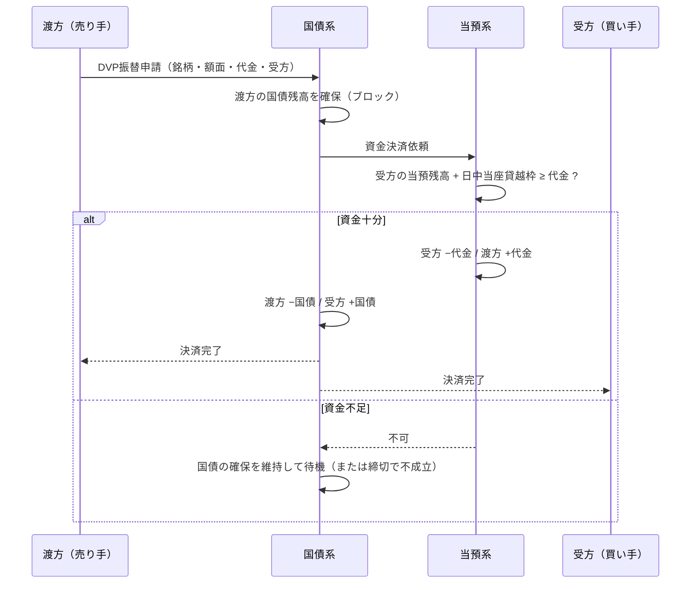
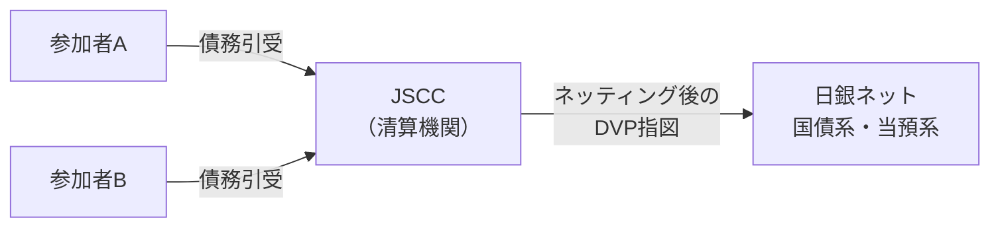

# 第3章 国債DVP決済の仕組み

[← 前章：RTGSと流動性節約](./02_rtgs_and_lsf.md) ｜ [目次](./README.md) ｜ [次章：日中流動性 →](./04_intraday_liquidity.md)

---

## 3.1 元本リスクとDVP

国債の売買で「国債を渡したのに代金が来ない」「代金を払ったのに国債が来ない」と、取引金額の全額（元本）を失うおそれがあります。これを **元本リスク** と呼びます。

**DVP（Delivery versus Payment）** は、国債の振替と資金の振替を相互に紐づけ、**一方が行われない限り他方も行われない** ようにする仕組みです。日本銀行は **日銀ネット当預系と国債系をリンク** させることで国債DVPを提供しています（1994年開始、2001年からRTGSベース）。

## 3.2 処理の流れ（グロス・グロス型）

日銀ネットの国債DVPは、国債も資金も1件ずつ同時に決済する方式（BISの分類でいう **DVPモデル1：グロス・グロス**）です。

ポイント：
- **原子性（アトミック性）**：資金と国債のどちらか一方だけが動くことはない。
- 国債残高の確保 → 資金の確認 → 同時記帳、の順序で処理。
- 日本銀行自身は売買の当事者にならず、信用リスク・流動性リスクを負わない。

## 3.3 清算機関を介したDVP

国債店頭取引の多くは、日本証券クリアリング機構（JSCC）の清算を経由します。

- CCPは参加者間の取引をネッティングし、圧縮された受渡しを日銀ネットでDVP決済します。
- 2019年の決済システムレポートでは、国債店頭取引の決済金額の **圧縮率が20%台前半** と報告されています（ネッティング効果）。
- **フェイル**（期日に決済できない状態）の取扱いは清算機関の業務方法書等で規定されます。

## 3.4 DVPと流動性の関係

グロス・グロス型DVPは安全ですが、1件ごとに総額の資金が必要です。そこで日本銀行は次の機能を用意しています（詳細は次章）。

- **日中当座貸越**：担保の範囲で日中に資金を立て替える。
- **同時担保受払機能**：DVPで受け取る国債を、そのまま日中当座貸越の担保として差し入れることで、購入資金を賄う。

## 確認問題

Q1. DVPで防げるリスクは何か？

元本リスクです。国債を渡したのに代金を受け取れない（またはその逆）という、取引金額全額を失うリスクを防ぎます。

Q2. 日銀ネットのDVPはBISの分類でどのモデルか？

国債も資金も1件ずつ同時に決済する「DVPモデル1（グロス・グロス）」です。

## 参考資料

- 日本銀行「国債振替決済制度」に関する情報開示（DVP、同時担保受払機能の説明） https://www.boj.or.jp/paym/outline/pay_boj/rel170620d.pdf
- 日本銀行「決済システムレポート（2019年3月）」 https://www.boj.or.jp/research/brp/psr/psr190327.htm
- BIS CPSS "Delivery versus payment in securities settlement systems"（1992年） https://www.bis.org/cpmi/publ/d06.htm
