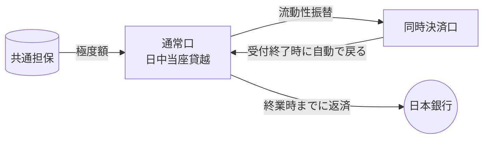
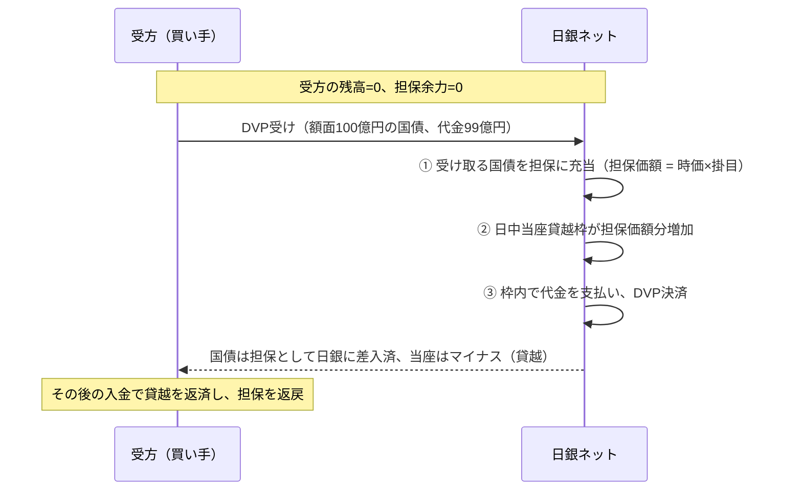

# 第4章 日中流動性：日中当座貸越と同時担保受払

[← 前章：国債DVP](./03_jgb_dvp.md) ｜ [目次](./README.md) ｜ [次章：民間決済システムとの連携 →](./05_private_system_links.md)

---

## 4.1 なぜ日中流動性が必要か

RTGSでは1件ごとに総額を支払うため、1日の中で「先に払って、後で受け取る」タイミングのずれが生じます。このずれを埋める資金が **日中流動性** です。

```
残高
 ▲
 │      受取        受取
 │    ┌──┐      ┌────┐
 │────┘  │      │    └──── 終業時残高
 │       └──┐   │
 0 ─────────│───│──────────────▶ 時刻
            └───┘  ← この落ち込みを日中当座貸越で埋める
```

## 4.2 日中当座貸越

| 項目 | 内容 |
|---|---|
| 目的 | RTGS処理に伴う日中の資金不足を一時的に補う |
| 導入 | 2001年1月のRTGS化と同時（与信・担保システム稼働） |
| 対象勘定 | **同時決済口以外** の当座勘定（通常口） |
| 上限（極度額） | 差し入れた **適格担保の担保価額** の合計額 |
| 返済 | 貸越を行った日の **終業時** まで |
| 利息 | 徴収しない |
| 終業時に残った場合 | **基準貸付利率に年6％を加えた利率** で延滞利息を徴収 |
| 翌日に持ち越したい場合 | 終業前に **補完貸付**（基準貸付利率、翌営業日返済）を受けて置き換える |

### 計算イメージ

- 支払可能額 ＝ 当座預金残高 ＋（日中当座貸越の上限 − 利用額）
- 当座預金残高がマイナスになっている部分 ＝ 日中当座貸越の利用額

### 同時決済口との関係

同時決済口では日中当座貸越は使えません。同時決済口で多くの支払が必要なときは、通常口で日中当座貸越を使い、その資金を **流動性振替** で同時決済口に移します。投入した流動性は、同時決済口の受付終了時に通常口へ戻り、日中当座貸越の返済にあてられます。



## 4.3 共通担保

日本銀行の与信（日中当座貸越、共通担保オペ、補完貸付）は **共通担保** の考え方で管理されます。国債、地方債、政府保証債、社債、CP、手形、証書貸付債権などの適格担保を一括して差し入れ、その担保価額（時価 × 掛目）の範囲で各与信を利用できます。

## 4.4 同時担保受払機能

国債DVPで国債を購入する際、購入資金が足りなくても、**その購入する国債自体を担保として同時に差し入れ**、日中当座貸越で代金を支払うことができる機能です。



- 「資金がなくても買える」のではなく、**買った資産を担保に日中だけ資金を借りる** 仕組み。
- 掛目（ヘアカット）があるため、代金全額を担保価額で賄えない場合は差額分の資金・担保余力が必要。
- 日中のうちに売却代金や資金調達で貸越を返済する必要がある。

## 4.5 流動性管理の実務

参加金融機関は、次のような手段を組み合わせて日中の資金繰りを管理します。

1. 受払予定の把握（自行・顧客の大口決済、時点ネット決済の予定額）
2. 支払タイミングの調整（流動性節約機能の活用、早めの支払で全体の流れを円滑化）
3. 担保の事前差入と日中当座貸越枠の確保
4. コール市場等での資金調達
5. 準備預金（所要準備）の残高推移の管理

## 確認問題

<details><summary>Q1. 同時担保受払を使えば、資金がゼロでも国債を買えるか？</summary>

担保価額（時価×掛目）の範囲までです。掛目（ヘアカット）の分だけ代金に届かないので、差額は既存の担保余力か資金で賄う必要があります。模擬システムのシナリオ `dvp` で確かめられます。
</details>

<details><summary>Q2. 日中当座貸越を返せないまま終業時を迎えると何が起きるか？</summary>

基準貸付利率に年6％を加えた利率で延滞利息がかかります。補完貸付に置き換えれば基準貸付利率で翌営業日まで借りられます。
</details>

## 参考資料

- 日本銀行「国債振替決済制度」に関する情報開示（日中当座貸越機能・同時担保受払機能） https://www.boj.or.jp/paym/outline/pay_boj/rel210730g.pdf
- 日本銀行「日中当座貸越」 https://www.boj.or.jp/paym/torihiki/touyo11.htm
- 日本銀行「補完貸付制度」 https://www.boj.or.jp/mopo/measures/mkt_ope/len_a/index.htm
- 日本銀行「国債決済RTGS化に伴う日銀ネット国債系稼働時間延長幅の拡大について」（2000年：RTGS化と与信・担保システム） https://www.boj.or.jp/paym/bojnet/rtgs/set0009b.htm
