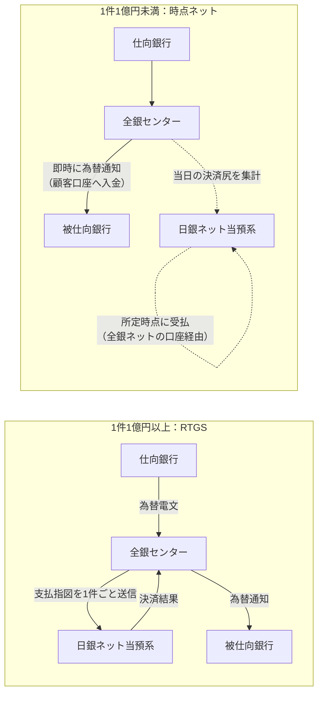
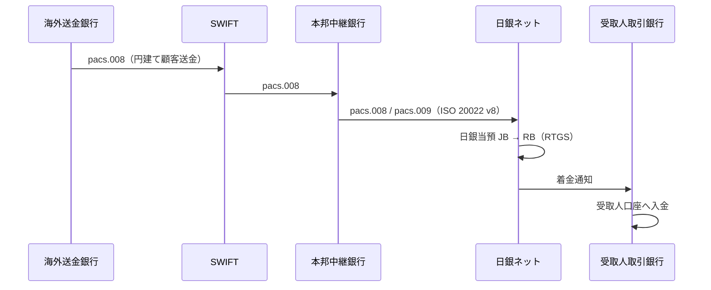

# 第5章 民間決済システム・海外との連携の仕組み

[← 前章：日中流動性](./04_intraday_liquidity.md) ｜ [目次](./README.md) ｜ [次章：リスク管理と業務継続 →](./06_risk_and_bcp.md)

---

## 5.1 全銀システム（内国為替）

- **大口内為取引**（1件1億円以上）：2011年11月以降、支払指図ごとに全銀センターから日銀ネットに送信され、日銀当預の **同時決済口** で RTGS（流動性節約機能付き）により決済。
- **小口内為取引**：顧客口座への入金は先行し、銀行間は **決済尻（受取額と支払額の差額）を時点決済**。全銀ネットは担保・流動性供給の仕組みで未決済リスクに備えます。
- 2018年10月からは全銀システムの24時間365日稼働（モアタイムシステム）が開始。夜間・休日分の銀行間決済尻は、日銀ネット稼働日に決済されます。

## 5.2 外国為替円決済制度

- 海外からの円送金、外為取引に伴う円資金の決済を集中的に行う制度（全国銀行協会が運営）。
- **2008年10月から完全RTGS**。日銀ネットの ISO 20022 電文で送受信し、**同時決済口** で決済（CLS関連を除く）。
- 海外の送金依頼（SWIFT電文）を日銀ネット電文に転記して処理。2025年11月にVersion 8に統一し、情報欠落なく伝達できるようになりました。

## 5.3 電子交換所（手形・小切手）

- 交換所で計算された受払差額（交換尻）は、**当日15時** に各金融機関と全国銀行協会の間で日本銀行当座預金の入金・引落により決済。

## 5.4 証券決済インフラ

| インフラ | 日銀ネットとの関係 |
|---|---|
| 日本証券クリアリング機構（JSCC） | 国債店頭取引・取引所取引の清算。国債DVP、資金決済に日銀当預を利用 |
| 証券保管振替機構（ほふり） | 社債・株式・投信等の振替。資金決済は日銀当預（DVP） |

## 5.5 海外との連携

- **CLS（外為PvP決済）**：円の受払は日銀当預で行われ、各国通貨の同時決済でヘルシュタット・リスクを削減。稼働時間のオーバーラップが前提。
- **クロスボーダー担保**：香港金融管理局との連携により、日本国債を担保に香港ドル等の流動性を得る仕組み。
- **稼働時間拡大**：21時までの稼働で、アジアの日中・欧州の午前と重複し、クロスボーダー円決済が行いやすくなりました。

## 確認問題

Q1. 外国為替円決済制度の決済方式は？

2008年10月から完全なRTGSです。日銀ネットの同時決済口で決済されます。

Q2. 2025年11月の ISO 20022 バージョン改訂の狙いは？

SWIFTのクロスボーダー電文（ISO 20022 Version 8）と日銀ネットの電文を揃え、送金情報を欠落させずに受取人まで届けるためです（マネー・ローンダリング対策にも重要）。

## 参考資料

- 日本銀行「教えて！にちぎん：民間資金決済システムでの金融機関間の受払」 https://www.boj.or.jp/about/education/oshiete/kess/i27.htm
- 全国銀行協会「外国為替円決済制度におけるISO20022電文バージョン改訂について」 https://www.zenginkyo.or.jp/news/2025/n101401/
- 日本銀行「決済システムレポート（2019年3月）」 https://www.boj.or.jp/research/brp/psr/psr190327.htm
- 日本銀行「中央銀行決済システムの将来」関連公表（クロスボーダー円建て決済の例） https://www.boj.or.jp/paym/bojnet/net_forum/rel170425b.htm
