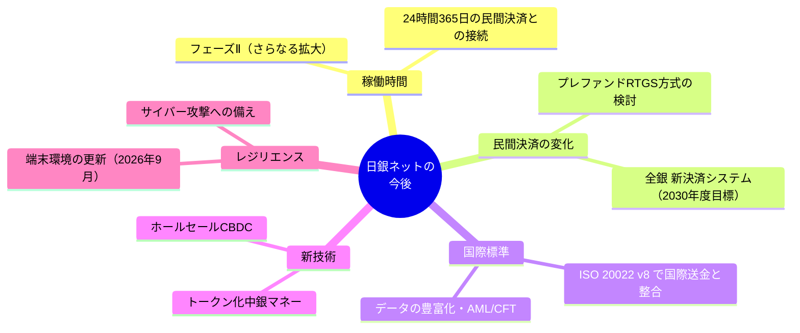

# 第8章 今後の展望と論点

[← 前章：海外との比較](./07_international_comparison.md) ｜ [目次](./README.md)

---

## この章で分かること

- 日銀ネットを取り巻く、2026年時点の主な変化と検討課題
- 民間の決済システム（全銀システム）の将来像が日銀ネットに与える影響

---

## 8.1 全体像

## 8.2 民間決済システムの将来像との関係

全国銀行資金決済ネットワーク（全銀ネット）の「資金決済システムの将来像に関するスタディグループ」は、2026年3月に検討結果を公表しました。

| 項目 | 内容 |
|---|---|
| 新決済システム | 24時間365日稼働を前提に、**2030年度** の稼働を目標とする。構築の是非は **2026年度末** に決める予定 |
| 現行システムとの関係 | 当面は現行の全銀システムと併存。2033年度にチェックポイントを設け、2038年度の現行システム更改時に役割分担を検討 |
| 電文 | ISO 20022 ベースの電文を採用し、現行の全銀フォーマットとの変換機能を提供 |
| 資金清算 | 現行は1億円以上の大口が日銀ネットでRTGS、1億円未満は時点ネット決済。新システムでは、海外の **プレファンドRTGS方式**（中銀当座預金を1件ずつ動かさず、運営機関の帳簿上の口座で処理する方式）を含めて検討し、日本銀行・金融庁と協議するとしている |

**日銀ネットへの含意**：プレファンドRTGS方式では、参加行があらかじめ中銀マネーを拠出しておけば、中銀のRTGSが24時間動いていなくても民間システムは即時決済を続けられます。このため、日銀ネットの稼働時間と、民間システムへの資金の拠出・戻しの仕組みの設計が論点になります。

## 8.3 稼働時間のさらなる拡大（フェーズⅡ）

21時までの拡大（フェーズⅠ）の後、「日銀ネットの有効活用に向けた協議会」で、さらなる拡大（フェーズⅡ）が議論されてきました。

| 論点 | 内容 |
|---|---|
| 需要 | 欧米時間帯のクロスボーダー円決済、外為のPvP決済、企業の資金管理の高度化 |
| コスト | 参加金融機関の要員・システム運用の負担 |
| 流動性 | 夜間に参加者が少ないと受払が偏り、待ち合いが起きやすい |
| 民間システムとの連携 | 24時間365日の民間決済と、中銀マネーでの最終決済のつなぎ方 |

## 8.4 新技術：トークン化と中央銀行マネー

- 日本銀行は一般利用型CBDCの実験・検討を進めています（「中央銀行デジタル通貨に関する日本銀行の取り組み」2026年5月）。
- 同資料は、資産のトークン化が進む一方でマネーのトークン化は十分に進んでいないとし、**中銀マネーのトークン化** を含めた将来のユースケースや実務課題の検討が必要としています。
- 海外では、ECBがDLTベースのホールセール決済に使うトークン化中銀マネーの開発方針を示し、韓国がホールセールCBDCの実証を進めています。

将来、トークン化された証券や預金の決済でも中央銀行マネーによるファイナリティをどう提供するかは、日銀ネットのような中銀決済インフラの役割に関わる論点です。

## 8.5 レジリエンス

- 端末の旧OS構成のサポートが2026年9月に終了し、Windows 11＋Edge の構成へ移行します（[仕様 第3章](../01_spec/03_connectivity.md)）。
- サイバー攻撃や不正な支払指図への備え（エンドポイント・セキュリティ）は、国際的にも重要課題とされています（[第6章](./06_risk_and_bcp.md)）。

## 確認問題

Q1. プレファンドRTGS方式とは何か。日銀ネットにどう関係するか？

参加行があらかじめ中央銀行マネーを民間決済システムの運営機関の口座に拠出しておき、民間システム内の帳簿上で即時に決済する方式です。中銀のRTGSが動いていない時間帯も民間システムは即時決済を続けられます。そのため、日銀ネットの稼働時間や、資金の拠出・戻しの仕組みの設計が論点になります。

Q2. 全銀ネットの新決済システムの稼働目標はいつか？

2030年度です（構築の是非は2026年度末に決める予定）。

## 参考資料

- 全銀ネット「資金決済システムの将来像に関するスタディグループにおける検討結果」（2026年3月） https://www.zengin-net.jp/announcement/pdf/announcement_20260319-2.pdf
- 日本銀行決済機構局「中央銀行デジタル通貨に関する日本銀行の取り組み」（2026年5月） https://www.boj.or.jp/paym/digital/dig260604b.pdf
- 日本銀行「日銀ネットの有効活用に向けた協議会」 https://www.boj.or.jp/paym/bojnet/net_forum/index.htm
- 日本銀行システム情報局「日銀ネットを利用するための機器等（端末装置用）」（2026年3月） https://www5.boj.or.jp/bojnet/pc/data/pc02a.pdf
