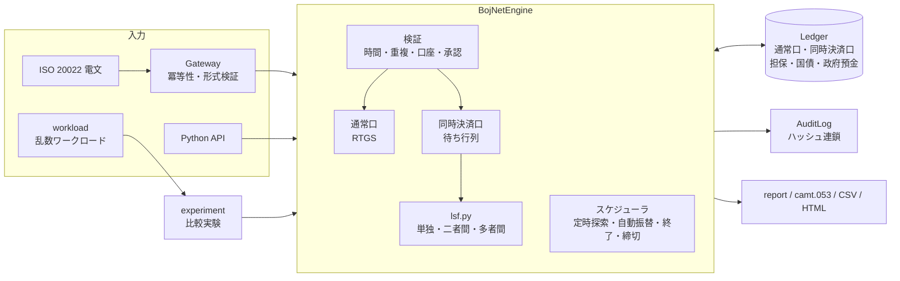

# 第Ⅲ部 模擬システム（bojnet_sim v2）

[← トップへ戻る](../README.md)

仕様編・仕組み編で解説した日銀ネットの仕組みを、手元で動かして確かめるための **学習用模擬システム** です。

- **Python版**：Python 3.10 以上の **標準ライブラリのみ** で動作（追加インストール不要）
- **ブラウザ版**：[`web/index.html`](./web/index.html) をブラウザで開くだけで動く、同時決済口の対話型シミュレータ

> ⚠️ 公表情報に基づく概念モデルです。実際の日銀ネットの仕様・電文・判定アルゴリズム・時刻・運用とは異なり、業務や接続試験には使えません。

---

## 1. クイックスタート

```bash
cd 03_simulator
python -m bojnet_sim demo                 # 9つのデモシナリオ
python -m bojnet_sim demo lsf eod         # 個別に実行
python -m bojnet_sim simulate --theta 0.3 # 乱数の指図1,500件で1日を模擬（監査ログCSVを出力）
python -m bojnet_sim experiment           # 流動性水準×方式の比較実験（CSV＋HTMLレポート）
python -m unittest discover -s tests -v   # テスト（46件）
```

ブラウザ版は `web/index.html` をダブルクリックで開きます。プリセット「4行の循環（グリッドロック）」→「次の定時探索まで」の順に押すと、多者間探索で循環が解ける様子が見られます。

## 2. 何を模擬しているか

| 仕組み | 模擬の内容 | 解説 |
|---|---|---|
| 稼働時間 | 8:30〜21:00、年末を除く月末は7:30開始、土日・指定休日は休業 | [仕様 第2章](../01_spec/02_operating_hours.md) |
| 通常口 | RTGS。支払可能額＝残高＋日中当座貸越の余力。不足なら拒絶（設定で待機も可） | [仕様 第5章](../01_spec/05_current_account_system.md) |
| 同時決済口 | 待ち行列（FIFO）、単独決済・**二者間探索（随時）**・**多者間探索（定時）**、順序変更、自動取消、受付終了時に残高を通常口へ | [仕組み 第2章](../02_mechanism/02_rtgs_and_lsf.md) |
| 流動性振替 | 通常口 ⇄ 同時決済口（手動・定時の自動振替） | [仕様 第5章](../01_spec/05_current_account_system.md) |
| 日中当座貸越 | 共通担保の範囲。終業時に残れば **基準貸付利率＋年6％** の延滞利息 | [仕組み 第4章](../02_mechanism/04_intraday_liquidity.md) |
| 補完貸付 | 担保の範囲・基準貸付利率・翌営業日返済。翌営業日の開始時に元本＋日数分の利息を返済 | [仕様 第8章](../01_spec/08_monetary_operations.md) |
| 国債DVP | 国債残高確保 → 資金確認 → 同時記帳（アトミック）。同時担保受払、フリー振替 | [仕組み 第3章](../02_mechanism/03_jgb_dvp.md) |
| 国債業務 | 発行・払込（政府預金へ）、利払、償還、レポ（2レグのDVP） | [仕様 第6章](../01_spec/06_jgb_system.md) |
| 時点ネット決済 | 受払合計ゼロの検証、全件決済か全件不成立（オール・オア・ナッシング） | [仕組み 第5章](../02_mechanism/05_private_system_links.md) |
| 電文 | pacs.009／pacs.002／camt.050／camt.053／sese.023（簡略版）、ゲートウェイの冪等性 | [仕様 第4章](../01_spec/04_message_format.md) |
| 統制 | マルチ承認（入力者≠承認者）、ハッシュ連鎖の監査ログ（改ざん検知） | [仕様 第3章](../01_spec/03_connectivity.md) |

### モデル値について

公表資料で時刻が明らかでないものは、[`config.py`](./bojnet_sim/config.py) にモデル値として置いています。

| 設定 | 既定値 | 根拠 |
|---|---|---|
| `lsf_open_time` / `lsf_close_time` | 9:00 / 17:00 | モデル値 |
| `multilateral_times` | 9:00, 11:00, 13:00, 15:00, 16:59（1日5回） | 回数は2012年の日本銀行の分析に合わせ、時刻はモデル値 |
| `base_lending_rate` | 0.75% | 設定値の例（実際の基準貸付利率は日本銀行の公表値を参照） |
| `overdue_penalty_add` | 6% | 日中当座貸越の規程（基準貸付利率＋年6％） |

## 3. デモシナリオ

| 引数 | 内容 |
|---|---|
| `rtgs` | 通常口のRTGSと日中当座貸越、支払可能額を超える指図の拒絶 |
| `lsf` | 流動性振替 → 二者間探索で即時に同時決済 → 循環は定時の多者間探索で解消 |
| `gridlock` | 同じ指図に対し、RTGS／二者間のみ／二者間＋多者間の結果を比較 |
| `dvp` | 国債DVP、同時担保受払、1日物レポ（スタート・エンド） |
| `issue` | 国債の発行・払込（払込不能の落札先を含む）と利払 |
| `net` | 時点ネット決済の成立・不成立と再決済 |
| `iso` | 電文ゲートウェイ：camt.050 → pacs.009 → 再送の冪等性 → sese.023 → 形式エラー → camt.053 |
| `approval` | マルチ承認（入力者自身の承認は拒否） |
| `eod` | 同時決済口の終了、補完貸付、延滞、翌営業日の返済、監査ログの検証 |

出力例（シナリオ `lsf` の一部）：

```
▶ A→B 50億 と B→A 45億：単独では払えないが、二者間探索で即座に同時決済
  09:05 [OFFSET2 ] L1 ⇄ L2 二者間同時決済 (5,000,000,000 / 4,500,000,000)
▶ B→C→D→B の循環（各 80億）：二者間では解けず待機
▶ 時計を 11:00 へ進める → 定時の多者間探索で3件が同時決済
  11:00 [SEARCH  ] 多者間探索（待機 3 件）
  11:00 [OFFSETN ] 3件を多者間同時決済（総額 24,000,000,000）
```

## 4. アーキテクチャ



| モジュール | 役割 |
|---|---|
| [`config.py`](./bojnet_sim/config.py) | 稼働時間、探索スケジュール、金利、承認の閾値 |
| [`op_calendar.py`](./bojnet_sim/op_calendar.py) | 営業日・稼働時間の判定 |
| [`models.py`](./bojnet_sim/models.py) | 指図（資金・DVP・ネットバッチ）、勘定、状態、貸付 |
| [`ledger.py`](./bojnet_sim/ledger.py) | 元帳（通常口・同時決済口・共通担保・振替国債・政府預金） |
| [`lsf.py`](./bojnet_sim/lsf.py) | 流動性節約機能の判定アルゴリズム（エンジンから独立） |
| [`engine.py`](./bojnet_sim/engine.py) | 決済エンジンと1日のスケジューラ |
| [`jgb_ops.py`](./bojnet_sim/jgb_ops.py) | 国債の発行・利払・償還・レポ |
| [`iso20022.py`](./bojnet_sim/iso20022.py) | 電文の生成・解析・検証 |
| [`gateway.py`](./bojnet_sim/gateway.py) | 電文の受付（コンピュータ接続の模擬） |
| [`audit.py`](./bojnet_sim/audit.py) | ハッシュ連鎖の監査ログ（JSON/CSV出力） |
| [`workload.py`](./bojnet_sim/workload.py) | 乱数ワークロードと流動性の上限・下限 |
| [`experiment.py`](./bojnet_sim/experiment.py) | 比較実験とHTMLレポート |
| [`report.py`](./bojnet_sim/report.py) | 残高表・待ち行列・統計の表示 |
| [`demo.py`](./bojnet_sim/demo.py) / [`__main__.py`](./bojnet_sim/__main__.py) | デモとコマンドライン |
| [`web/index.html`](./web/index.html) | ブラウザ版の対話型シミュレータ（同じアルゴリズムのJavaScript実装） |

## 5. シミュレーション実験

`python -m bojnet_sim experiment` は、同じ乱数の指図列に対して初期流動性と決済方式だけを変えて比較し、`output/` に CSV と HTML レポートを出力します。サンプル出力は [`sample_output/experiment_report.html`](./sample_output/experiment_report.html) にあります。

- 流動性水準 θ：各行の初期流動性 ＝ θ ×（全指図を到着時に即時決済するのに必要な流動性）
- 方式：RTGS／二者間／二者間＋定時多者間／二者間＋随時多者間
- 指標：決済できた金額の割合、金額加重平均の遅延（未決済は終了時刻まで待ったとみなす）、同時決済の比率、未決済件数

| θ | RTGS 決済率 | ＋二者間 | ＋定時多者間 | ＋随時多者間 |
|---|---:|---:|---:|---:|
| 0.10 | 29.2% | 29.2% | **58.9%** | **58.9%** |
| 0.25 | 78.2% | 78.2% | 80.2% | 80.2% |
| 0.40 | 88.6% | 88.6% | 88.6% | 88.6% |

（20先・1,500件・シード1）。流動性が乏しいほど多者間探索の効果が大きいことが分かります。

## 6. テスト

`tests/` に46件のテストがあります。

- **単体**：稼働時間、通常口、同時決済口、流動性振替、順序変更、自動取消、承認、締切と翌営業日、DVP、同時担保受払、国債業務、レポ、時点ネット、各電文の往復変換、ゲートウェイ、監査ログ
- **乱数による不変条件の検査**：20通りのシードで多数の指図を流し、次の3点を毎回確認
  1. 同時決済口の残高が負にならない
  2. 各行の支払順序（FIFO）が守られる
  3. 資金の総額が保存される
- **実験**：流動性が乏しいとき、同時決済が決済率と遅延を改善すること

## 7. プログラムから使う

```python
from datetime import datetime, time
from bojnet_sim import (BojNetEngine, Ledger, JgbIssue, SystemConfig,
                        PaymentInstruction, Category, DvpInstruction)

led = Ledger()
led.open_account("0001", "A銀行", balance=50_0000_0000, collateral=20_0000_0000)
led.open_account("0005", "B銀行", balance=50_0000_0000)
eng = BojNetEngine(led, SystemConfig(), start=datetime(2026, 10, 16, 8, 30))

eng.set_time(datetime(2026, 10, 16, 9, 30))
eng.transfer_liquidity("0001", 10_0000_0000)          # 通常口 → 同時決済口
p = eng.submit_payment(PaymentInstruction("P1", "0001", "0005", 30_0000_0000, Category.CALL))
print(p.status)                                        # 待機
eng.add_standing_transfer("0001", time(10, 0), 20_0000_0000)
eng.advance_to(datetime(2026, 10, 16, 10, 0))          # 定時の自動振替で決済
print(p.status, p.settled_by)                          # 決済済 単独
```

## 8. 拡張のアイデア

- 指図の優先度（緊急・通常）や、相手先別の送信上限
- 全銀システム小口の時点ネット決済に、担保・流動性供給の仕組みを加える
- プレファンドRTGS方式（[仕組み 第8章](../02_mechanism/08_future_outlook.md)）の模擬
- CLS型のPvP、クロスボーダー担保
- XSDによる厳密なスキーマ検証
