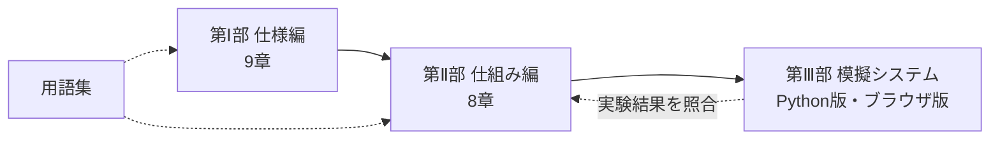

# 日銀ネット 体系ガイド ― 仕様・仕組み・模擬システム

日本銀行が運営する **日銀ネット（日本銀行金融ネットワークシステム／BOJ-NET）** について、公表情報をもとに **仕様**・**仕組み**・**模擬システム** の3部構成で体系的に整理した資料集です。

> 📅 版：v2.0（2026年10月16日）　｜　[変更履歴](./CHANGELOG.md)　｜　[用語集](./GLOSSARY.md)
> ⚠️ 本資料は日本銀行の公式資料ではありません。正確な仕様・規程は日本銀行の一次資料と利用先向け資料で必ず確認してください。

---

## 日銀ネットを3行で

1. 日本銀行と金融機関を結び、**円資金（日銀当座預金）と国債** を決済するシステム。1営業日に **約10万件・約250兆円** の資金決済が行われています（2026年5月の日次平均）。
2. 資金は **RTGS（1件ずつ即時に決済）** が基本です。当座預金は **通常口**（日中当座貸越あり）と **同時決済口**（待ち行列と同時決済で流動性を節約）の2つの勘定に分かれています。
3. 国債は **DVP（資金と同時受渡）** で決済されます。電文は **ISO 20022**、稼働時間は **8:30〜21:00** です。

## 全体構成

```
bojnet-guide/
├── README.md              ← このファイル（総目次）
├── GLOSSARY.md            用語集
├── CHANGELOG.md           変更履歴
├── 01_spec/               第Ⅰ部 仕様編（何を・いつ・どの形式で）    9章
├── 02_mechanism/          第Ⅱ部 仕組み編（なぜ・どのように）        8章
└── 03_simulator/          第Ⅲ部 模擬システム（動かして確かめる）
    ├── bojnet_sim/        Python版（標準ライブラリのみ）
    ├── web/index.html     ブラウザ版の対話型シミュレータ
    ├── tests/             テスト46件
    └── sample_output/     比較実験のレポート例
```



## 第Ⅰ部 仕様編 ― [目次](./01_spec/README.md)

| 章 | タイトル |
|---|---|
| 第1章 | [日銀ネットの概要と沿革](./01_spec/01_overview.md) |
| 第2章 | [稼働時間と1日の業務スケジュール](./01_spec/02_operating_hours.md) |
| 第3章 | [接続方式とネットワーク構成](./01_spec/03_connectivity.md) |
| 第4章 | [電文仕様（ISO 20022）](./01_spec/04_message_format.md) |
| 第5章 | [当預系（日本銀行当座預金取引）の業務仕様](./01_spec/05_current_account_system.md) |
| 第6章 | [国債系（国債関係事務）の業務仕様](./01_spec/06_jgb_system.md) |
| 第7章 | [参加資格・運用規程・ガバナンス](./01_spec/07_participation_and_governance.md) |
| 第8章 | [日本銀行との取引：金融調節・貸出・国庫金](./01_spec/08_monetary_operations.md) |
| 第9章 | [数値で見る日銀ネット](./01_spec/09_statistics.md) |

## 第Ⅱ部 仕組み編 ― [目次](./02_mechanism/README.md)

| 章 | タイトル |
|---|---|
| 第1章 | [わが国決済システムの全体像と日銀ネットの位置付け](./02_mechanism/01_payment_landscape.md) |
| 第2章 | [RTGS・時点ネット決済・流動性節約機能](./02_mechanism/02_rtgs_and_lsf.md) |
| 第3章 | [国債DVP決済](./02_mechanism/03_jgb_dvp.md) |
| 第4章 | [日中流動性：日中当座貸越と同時担保受払](./02_mechanism/04_intraday_liquidity.md) |
| 第5章 | [民間決済システム・海外との連携](./02_mechanism/05_private_system_links.md) |
| 第6章 | [リスク管理と業務継続（BCP）](./02_mechanism/06_risk_and_bcp.md) |
| 第7章 | [海外の中央銀行RTGSとの比較](./02_mechanism/07_international_comparison.md) |
| 第8章 | [今後の展望と論点](./02_mechanism/08_future_outlook.md) |

## 第Ⅲ部 模擬システム ― [README](./03_simulator/README.md)

| 形態 | 使い方 | 主な内容 |
|---|---|---|
| ブラウザ版 | [`03_simulator/web/index.html`](./03_simulator/web/index.html) を開く | 同時決済口の待ち行列・二者間／多者間探索を、ネットワーク図で見ながら操作 |
| Python版 デモ | `python -m bojnet_sim demo` | 9シナリオ（RTGS、同時決済口、グリッドロック、DVP、国債発行、時点ネット、電文、承認、締切） |
| Python版 実験 | `python -m bojnet_sim experiment` | 流動性水準×決済方式の比較。結果は CSV と HTML レポート（[例](./03_simulator/sample_output/experiment_report.html)） |

```bash
cd 03_simulator
python -m bojnet_sim demo                 # デモ
python -m bojnet_sim experiment           # 比較実験
python -m unittest discover -s tests -v   # テスト
```

## 読み方ガイド

| 目的 | おすすめの順序 |
|---|---|
| まず全体像をつかみたい | 仕様1章 → 仕組み1章 → 仕様9章（数値） |
| 決済方式を深く理解したい | 仕組み2章 → 仕様5章 → ブラウザ版 → 模擬 `experiment` |
| 国債決済を理解したい | 仕様6章 → 仕組み3・4章 → 模擬 `dvp` `issue` |
| システム接続・電文を知りたい | 仕様3・4章 → 模擬 `iso` |
| 日本銀行の与信と資金繰り | 仕様5・8章 → 仕組み4章 → 模擬 `rtgs` `eod` |
| 海外比較と将来 | 仕組み7・8章 |

## 情報の確度について

| 区分 | 扱い |
|---|---|
| 公表資料で確認できた事実 | 本文に記載し、章末に出典を明記 |
| 利用先向け資料にしかない細部（判定ロジック、正確な時刻、電文の項目定義など） | 「公表情報の範囲での整理」「モデル」と明記し、一般的な中銀RTGSの考え方で説明 |
| 模擬システムの値 | 設定ファイルに「モデル値」と明記。実際の値ではない |

## 主な一次資料

- 日本銀行「日銀ネットの運営」関連ページ https://www.boj.or.jp/paym/bojnet/index.htm
- 日本銀行「教えて！にちぎん：日銀ネットとは何ですか？」 https://www.boj.or.jp/about/education/oshiete/kess/i10.htm
- 日本銀行「日銀ネットにおけるオンライン入力開始時刻等に関する件」 https://www.boj.or.jp/paym/bojnet/bojnet01.htm
- 日本銀行決済機構局「次世代RTGSプロジェクト －第1期対応を中心に－」 https://www.boj.or.jp/paym/bojnet/next_rtgs/set0810a.pdf
- 日本銀行「日中当座貸越」 https://www.boj.or.jp/paym/torihiki/touyo11.htm
- 日本銀行「決済動向」 https://www.boj.or.jp/statistics/outline/exp/exkess.htm
- 日本銀行「日銀ネットの有効活用に向けた協議会」 https://www.boj.or.jp/paym/bojnet/net_forum/index.htm
